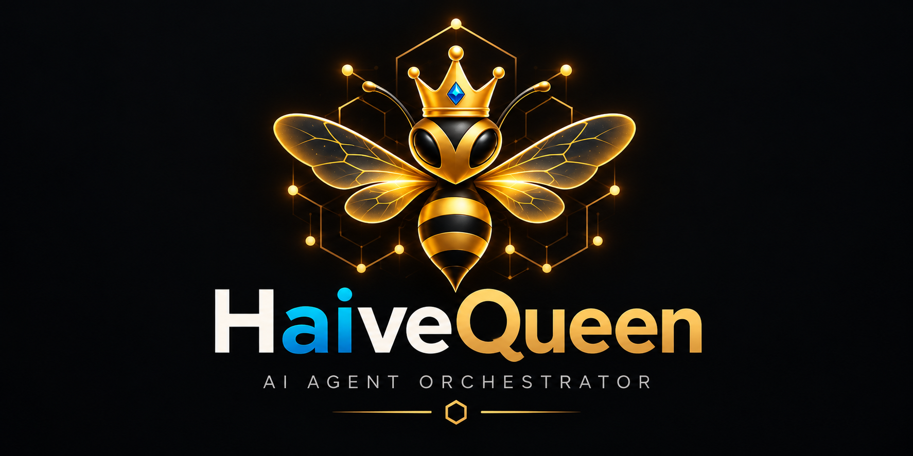
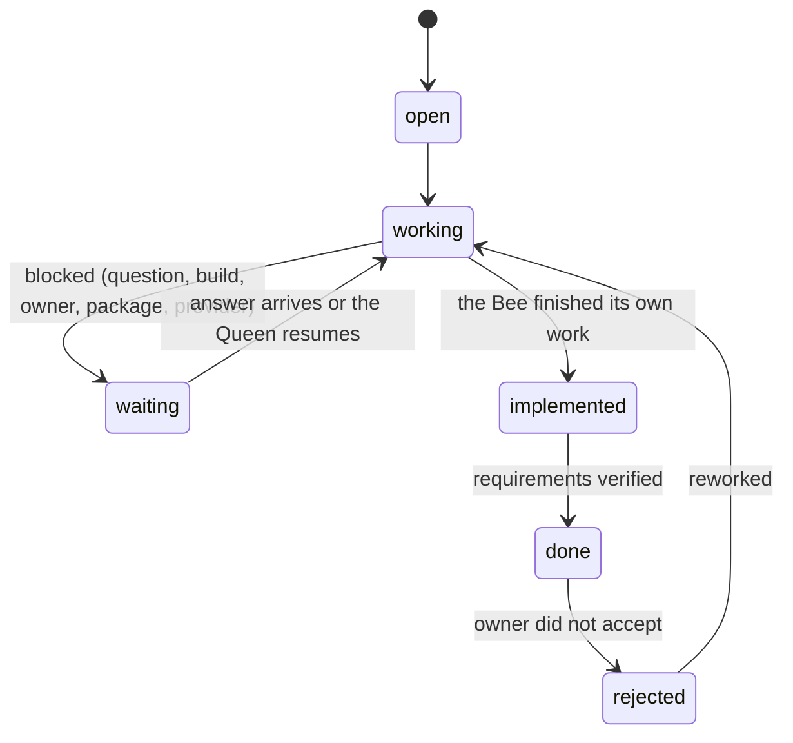
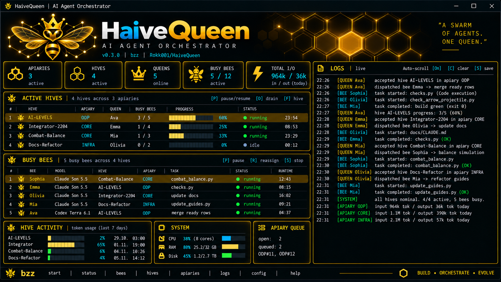

<p align="center">
  
</p>

<p align="center">
  <a href="https://github.com/Rokk001/HaiveQueen/actions/workflows/test.yml"></a>
  <a href="LICENSE"></a>
  
  
</p>

<p align="center"><b>Run plans with Queens and parallel Bees: write a plan, set it to QUEUED (or SENT to have it cut), and HaiveQueen works it through.</b></p>

---

HaiveQueen is a local orchestrator for coding agents ([Claude Code](https://claude.com/claude-code) and the Codex CLI out of the box, any other command through a provider entry). You describe the work as a Markdown plan with packages. For every plan HaiveQueen opens a **Hive**: one **Queen** works the plan, starts **Bees** for independent packages, checks that every requirement is met and integrates the result. You watch and steer everything in one graphical window. No prompts to copy, no terminal to babysit.

- [Why](#why) · [How it works](#how-it-works) · [Quick start](#quick-start) · [Plans](#plans) · [Dashboard](#dashboard)
- [Failures and escalation](#failures-and-escalation) · [Configuration](#configuration) · [Inbox](#inbox) · [Command line](#command-line)
- [Documentation](#documentation) · [Development](#development) · [FAQ](#faq) · [License](#license)

## Why

**1. It runs in its own profile, so your private instructions never reach its agents.** HaiveQueen is a development environment of its own. Every agent it starts (Claude, Codex, OpenCode, Kilo Code) works with one profile folder in HaiveQueen's data folder, never with your private files: your global `CLAUDE.md` or `AGENTS.md`, your memory, your settings and plugins stay beside it, untouched, and are not loaded. Each CLI is started with its config-dir variable pointing at the profile, which holds only the login and a few settings (auto memory and history off). Whatever you have piled into your own agents over time costs HaiveQueen's agents nothing. That is **very token-saving**, and you **run into provider limits much later**. Details: [`docs/PROFILE.md`](docs/PROFILE.md).

**2. Only the project rules, and only from the repository.** Queens and Bees load the complete project rules: the instruction files (`AGENTS.md`, `CLAUDE.md`) checked in to the project repository, plus those of an upstream repository when the project setting `upstreamRepo` names one. The README and untracked workspace files never count. A Queen additionally loads her plan, its state file, the handoff of her predecessor and the decisions and owner answers of her Apiary; nothing else. The Queen selects no rules for a Bee.

**3. Hives, one Queen and parallel Bees per plan.** Every plan gets a Hive. The Queen coordinates and never works a package herself; independent packages go to Bees of the right class, in parallel, and the Queen merges and integrates. Fresh, small contexts replace one huge one, and a context handoff lets a successor continue.

**4. A plan is not done because an agent says so.** Before integration the Queen lists every requirement of the plan with evidence in the state file under `## Completeness`. `bzz ready` is refused for a missing, open or partial requirement, and then an independent **check agent** (fresh, not part of the plan, read-only) compares the plan as submitted with the list and the branch. Only `READY-CHECK: PASSED` accepts the branch.

**5. A plan cutter with requirements and dependencies.** Hand over free text (`status = "SENT"`). The Queen first writes every requirement as `- <id>: <text>` into the state file, then cuts the plan into small packages with class, `depends_on` and the requirements each covers. `bzz plan check` refuses a cut in which a requirement belongs to no package.

**6. Role files you can read and change without code.** What the Queen, a Bee, the plan cutter and the check agent are told lives in plain Markdown files in [`roles/`](roles).

**7. Written for you, in your language.** The setting `language` (default English) decides the language of every free text agents write to you: questions, notes, final reports and state file entries. Protocol words stay fixed.

**8. Answer once for the whole Apiary.** When you answer a question, a box applies the answer to the whole Apiary: it is stored as a decision for every plan of that Apiary (never another one) and the same question is not asked again. Queens read the decisions first and close a question that a decision already settles.

**9. Control from one window.** The `hives` button lists the plans of all Apiaries with their status, including plans that never had a Hive, and starts, pauses, rejects or puts a plan back to draft on a right click. The Queen menu restarts a Queen, also on another provider.

**10. Integration to your integration branch.** The Queen merges the project's integration branch (setting `integrationBranch`, default `main`) into her branch, runs the project check and integrates one Hive at a time per project. After deploy you accept with an owner check, or the next Queen fixes exactly what you reject.

Also: the manager is not a model (the Beekeeper is a plain program loop that costs no tokens), providers are chosen by the free weekly limit and a Hive rests until the reset, and state lives in one local SQLite database, so after a crash the next start re-attaches to agents that are still alive.

## Words

| Word | Meaning |
|---|---|
| **Apiary** | a project (a repository with a `.haivequeen/project.toml`) |
| **Hive** | one plan of an Apiary, worked by one Queen at a time |
| **Queen** | the main agent of a Hive: works the plan, delegates, checks completeness, integrates |
| **Bee** | a helper agent that works one package for its Queen |
| **Beekeeper** | the managing loop: no model, no window, a hidden background process |

## How it works

1. **Plan.** You write a plan (Markdown with a TOML header, see [Plans](#plans)) and set `status = "QUEUED"`. That is the release; there is no submit step. A draft started with **Start** in the Hives window becomes `SENT` and is cut by its Queen first.
2. **Start.** The Beekeeper reads SENT, PREPARING, QUEUED, RUNNING, WAITING and REVIEW plans, picks a provider that offers the Queen class and starts one Hive per plan within the machine-wide limits. Hives that can resume take precedence over new plans.
3. **Work.** The Queen coordinates and never works a package herself: every package goes to a Bee of its class, respecting dependencies and the Bee limit. Subagent Bees run in the foreground, independent ones in parallel from one message, so the Queen never polls a Bee. She answers technical questions, merges the Bee branches and, when every requirement is done, integrates (git, compile check, build). A package that needs a capability (for example `Image generation`) goes to a provider that offers it; local providers are used when available.
4. **Completeness.** Before integration the Queen answers the completeness question with evidence for every requirement and lists every requirement id once in the state file as `- <id>: done | <evidence>`; `bzz ready` is refused for missing, open or partial ids and a fresh check agent must pass the branch. Partial items count as open. Requirements covered exclusively by packages marked `verify = "owner"` are listed separately as owner checks.
5. **Integration.** She merges the current integration branch into her branch, runs the project check, registers her branch and performs the project's integration steps. Only one integration per project runs at a time; a waiting Hive hands off and resumes when its turn comes.
6. **Acceptance and done.** After integration and a switched-on deploy HaiveQueen itself files an owner check question (`owner-check`, text from the setting `ownerCheckText`, by default "Check the integrated result" in the language setting): you check the result and answer `ok`, or say what is not right and the next Queen fixes exactly that. The plan status moves to DONE only after your `ok`; a plan whose header says `owner_check = "none"` skips the question and is done after integration.

Agent names can be edited in `bee_names.txt` in the HaiveQueen configuration directory. Changes take effect when the next agent starts.

Along the way:

- **Handoffs.** At the context limit no new Bees start, running Bees finish and a new Queen continues from the handoff.
- **Questions.** The Queen decides technical questions herself and records the decision (`bzz decisions add`, source `auto`); questions about the result’s behaviour, content or design, and topics configured by the Apiary to always go to you, go to you with `bzz ask`, and a question that an earlier decision or answer already settles is closed by reference. An open owner question pauses only the item it blocks; independent work goes on. Any answer can resume the Hive.
- **Slots and provider choice.** Every running Queen takes one slot of her provider and every Bee takes one slot of the provider it runs on, a subagent Bee inside its Queen included (a Claude Queen with two subagent Bees holds 3 Claude slots); a subagent Bee keeps its slot until HaiveQueen has closed its end. A Queen needs one free slot to start. When her provider has no free slot for a Bee, the Bee starts as a separate process on another provider by the normal provider choice (class, capabilities, quota reserve), and a stored package assignment to the full provider moves to that one; only when no provider has a free slot does the Bee wait, and a waiting Bee of a running Queen gets the last free slot before a new Queen. Every new Queen of an existing Hive chooses its provider by the normal provider choice (quota reserve, slots, class, Queen capability) just like a new Hive, also after a vanished Queen (who keeps her class) or a wait for a provider; a running Queen is never moved or ended. Only the owner's explicit choice to restart the Queen on a given provider binds the Hive to it, until the owner changes it.
- **Provider limits.** At a provider's limit the Hive rests until the reset; its next Queen then chooses its provider by the normal provider choice.
- **Interruptions** (laptop sleep, network or API errors, a vanished process) are retried with growing waits and never count as failures.

### Package states

Every package moves through a small state machine that the Queen reports with `bzz package`:



`implemented` means the work is written but not yet verified; `waiting` means someone else has to act first. Neither is a failure (see below). A rejected package is never counted as done, and `bzz ready` is refused until it is reworked.

## Quick start

**Requirements**

- Python 3.11 or newer, with tkinter (part of the standard Python installers) for the dashboard window
- at least one of the supported CLIs: [Claude Code](https://claude.com/claude-code) (`claude`), the Codex CLI (`codex`), [OpenCode](https://opencode.ai) (`opencode`) or [Kilo Code](https://kilo.ai) (`kilo`)
- Git (Hives work in worktrees)

**Steps**

```bash
git clone https://github.com/Rokk001/HaiveQueen
cd HaiveQueen
pip install -e .                      # installs dependencies and the command `bzz`

bzz init /path/to/my-project          # creates .haivequeen/project.toml, AGENTS.md and an example plan
bzz register /path/to/my-project      # adds the project to config.toml and the database
```

Each Apiary’s `.haivequeen/` folder contains machine-local settings and runtime files; keep it local to each machine and do not commit it. `bzz init` and `bzz register` add it to the project folder’s `.gitignore` and warn if it is already tracked.


To install a particular release instead of the newest code, check out its tag after cloning (for example `git checkout v2.0.1`) before `pip install -e .`. Keep the clone where it is: the update function below installs new versions into that folder.

### Updates

HaiveQueen updates itself the same way for every user:

- Once a day (`update.checkHours` in `config.toml`, default 24; `0` or the environment variable `BZZ_NO_UPDATE_CHECK=1` switches the daily check off) and whenever you click **Check now** in the header of the dashboard, HaiveQueen asks GitHub whether a newer release exists. `bzz update` does the same check on the command line. A failed check (offline, rate limit) is shown in the header and tried again after the interval or with Check now.
- When one exists, the header shows **New version available: X – Update**. Nothing is installed until you click it and confirm.
- After the confirmation HaiveQueen starts no new Queen or Bee, waits until every running agent of every Apiary has ended (it ends none), fast-forwards the clone to the release tag `vX`, runs `pip install -e .` again when `pyproject.toml` changed and starts again; the dashboard reopens with the new version. If the new version does not start, it goes back to the previous one and files a question. `bzz update --install X` does the same for the offered version X.
- The header shows the installed version: the release tag of the clone (without one, the version in `pyproject.toml`).
- The releases come from the GitHub repository of the clone's `origin` remote; `update.repository = "owner/name"` in `config.toml` names another one. Local commits on the clone's branch stop the fast-forward; the update then fails and keeps the installed version.

**Log in once per CLI, in the HaiveQueen profile.** Do this for every CLI you want to use, after `bzz register`. The agents never read your own login (see [Why](#why)), so each CLI needs its login in the profile folder `<data folder>/profile/<cli>` (data folder: `%LOCALAPPDATA%\HaiveQueen` on Windows, `${XDG_DATA_HOME:-~/.local/share}/HaiveQueen` on Linux). Set the variable(s) that point the CLI to that folder, then run its login command:

PowerShell (Windows):

```powershell
# Claude
$env:CLAUDE_CONFIG_DIR = "$env:LOCALAPPDATA\HaiveQueen\profile\claude"; claude auth login
# Codex
$env:CODEX_HOME = "$env:LOCALAPPDATA\HaiveQueen\profile\codex"; codex login
# OpenCode
$p = "$env:LOCALAPPDATA\HaiveQueen\profile\opencode"; $env:OPENCODE_CONFIG_DIR = "$p\config"; $env:XDG_CONFIG_HOME = "$p\config"; $env:XDG_DATA_HOME = "$p\data"; $env:XDG_STATE_HOME = "$p\state"; $env:XDG_CACHE_HOME = "$p\cache"; opencode auth login
# Kilo Code
$p = "$env:LOCALAPPDATA\HaiveQueen\profile\kilo"; $env:KILO_CONFIG_DIR = "$p\config"; $env:XDG_CONFIG_HOME = "$p\config"; $env:XDG_DATA_HOME = "$p\data"; $env:XDG_STATE_HOME = "$p\state"; $env:XDG_CACHE_HOME = "$p\cache"; kilo auth login
```

bash (Linux):

```bash
# Claude
CLAUDE_CONFIG_DIR="${XDG_DATA_HOME:-$HOME/.local/share}/HaiveQueen/profile/claude" claude auth login
# Codex
CODEX_HOME="${XDG_DATA_HOME:-$HOME/.local/share}/HaiveQueen/profile/codex" codex login
# OpenCode
p="${XDG_DATA_HOME:-$HOME/.local/share}/HaiveQueen/profile/opencode"; OPENCODE_CONFIG_DIR="$p/config" XDG_CONFIG_HOME="$p/config" XDG_DATA_HOME="$p/data" XDG_STATE_HOME="$p/state" XDG_CACHE_HOME="$p/cache" opencode auth login
# Kilo Code
p="${XDG_DATA_HOME:-$HOME/.local/share}/HaiveQueen/profile/kilo"; KILO_CONFIG_DIR="$p/config" XDG_CONFIG_HOME="$p/config" XDG_DATA_HOME="$p/data" XDG_STATE_HOME="$p/state" XDG_CACHE_HOME="$p/cache" kilo auth login
```

Without a login a provider counts as not available and its packages wait; all others go on. You can also do this from the dashboard: the settings window shows "Login present" or "Login missing" on every provider's page, and its **Login** button opens a terminal window with the variables set and the login command running. For a CLI HaiveQueen does not know, set `outputFormat` (the format it writes: `claude`, `codex` or `opencode`; without one of them the provider is rejected with a clear message), `profileEnv`, `loginCommand` and `loginFiles` in its provider entry (see [`examples/config.example.toml`](examples/config.example.toml)); the same status, profile and button then work for it.

```bash
bzz start                             # starts the loop in the background and opens the dashboard window
bzz stop                              # no new agents; running agents finish their task
```

Put your machine settings (providers, slots) into `config.toml` (see [`examples/config.example.toml`](examples/config.example.toml); folder: `%APPDATA%\HaiveQueen` on Windows, `~/.config/HaiveQueen` on Linux).

### Setting up a provider

Open the settings window (`config`) and use **Add provider**. One form holds everything: at the top the switch **Enabled** (on by default; a disabled provider gets no new Queen or Bee, no usage check and appears nowhere in the dashboard, but stays in the list, dimmed, with all its values, and running agents finish), then the name and the dropdown **Access type** (Subscription, API key or Local LLM) decides which fields the form shows. **CLI** (Claude Code, Codex CLI, OpenCode, Kilo Code; Custom CLI only for Subscription), **Models** (light, medium, heavy), **Use** and **Advanced** are the same for every access type.

- **Subscription.** Choose the CLI and press **Login** (or log in as described above). The login belongs to the CLI, so all providers with the same CLI share it.
- **API key.** Choose a CLI that can run with a key (Claude Code, Codex CLI) and enter the key. It is shown masked and kept only in the machine `config.toml`; HaiveQueen hands it to the CLI only in the environment of the agent it starts (never in a profile file), so a Subscription login and API key providers of the same CLI, also with different keys, work side by side. The usage check of an API key provider is off by default.
- **Local LLM** (for example [LM Studio](https://lmstudio.ai) on another machine). Choose the CLI, enter the address (for example `http://192.168.1.20:1234`), an API key if the LLM needs one and the context window in tokens, and press **Test connection**. The test lists the models and shows for each CLI whether the LLM offers the interface it needs (Claude Code: Anthropic Messages, Codex: Responses, OpenCode and Kilo Code: OpenAI-compatible). The model fields offer the models of the last test; **Simultaneous agents** is the number of slots of this LLM. HaiveQueen starts the CLI with the address, key and context window itself, only inside the agent environment; no wrapper script is needed. This works the same on Windows, Linux and macOS. A Local LLM provider counts as local and needs no login. A provider without a usage limit (usage check `none`, as every Local LLM has) always ranks before the providers with a limit when it has a free slot, the class model and the capabilities; in the Model Limits panel its quota reserve shows as +99 %. Older `[[servers]]` entries are taken over into the providers that used them (an unused one becomes a Local LLM provider with 0 simultaneous agents and priority fallback) and removed when you save.

Address and key are machine settings: they are stored only in the machine `config.toml`.

The loop and all agents run as hidden background processes; the dashboard window is the only interface. Closing the window leaves the loop running, and `bzz start` opens it again without restarting agents. A start during a pending stop, during a running update or while another start is under way is refused: `bzz start` then exits with 1, and the reason is an event and a line in `runs/beekeeper.log`. A start while the loop runs still exits with 0. Windows desktop shortcuts can use `bzz start --desktop` and `bzz stop --desktop` for a visible result or error dialog; ordinary CLI calls keep their JSON output.

## Plans

A plan is a Markdown file with a TOML header between `+++` lines ([`examples/plan.example.md`](examples/plan.example.md)). Only a plan with one of the statuses `SENT`, `PREPARING`, `QUEUED`, `RUNNING`, `WAITING` or `REVIEW` starts agents. A broken header, an unknown status or an unknown class is shown as an error in the Hives window. A plan that names no branch gets the branch `<plan file name in lower case without -PLAN>`, created from `<remoteName>/<integrationBranch>`; when that branch already exists and the plan has no Hive history, you are asked whether to take it over or create a new one.

```toml
+++
status = "QUEUED"

[[packages]]
id = "P1"
title = "Add the parser"
class = "medium"        # light | medium | heavy: model and effort come from the provider
depends_on = []

[[packages]]
id = "P2"
title = "Draw the icons"
capability = "Image generation"   # only providers with this capability may run it
verify = "owner"        # code (default) | build | owner: who closes the last requirements
depends_on = ["P1"]

[[packages]]
id = "P3"
title = "Final check of the whole plan"
class = "heavy"
depends_on = ["all"]    # waits for every other package of this plan
+++
# My plan
Free Markdown below the header: the agents read it.
```

| Field | Meaning |
|---|---|
| `status` | `DRAFT` -> `SENT` -> `PREPARING` -> `QUEUED` -> `RUNNING` <-> `WAITING` -> `REVIEW` -> `DONE`, plus `PAUSED` and `CANCELLED`. `SENT` hands over a plan that is not cut yet (see below); `QUEUED` releases a cut plan; `PREPARING` (a Queen cuts it), `RUNNING`, `WAITING` (every open package waits; the Hives window says what for), `REVIEW` (integrated, waits for your owner check) and `DONE` are set by HaiveQueen; `PAUSED` stops new starts (window: `Space`); `CANCELLED` never starts again by itself. The old names `SUBMITTED`, `READY`, `IN_PROGRESS` and `REJECTED` are read as `SENT`, `QUEUED`, `RUNNING` and `CANCELLED` and written with the new name at the next status change |
| `class` | `light`, `medium` or `heavy`; the provider maps each class to a model and an effort |
| `depends_on` | package ids this one waits for, or `["all"]` |
| `capability` | only providers offering it may run the package. The name is free: you define it in the provider entry of the machine settings (`capabilities = ["Coding", "Queen", "Image generation", "3D modelling", "Build"]` and `capabilitiesVersion = 1`) and several providers may offer the same one, for example `3D modelling` or `Build` for work that only some models are suited for. A package whose provider is missing waits alone; one that another provider offers too goes there. |
| `owner_check` | header key (not per package): `"none"` skips the acceptance question after integration, anything else (default) asks you to test the integrated build |
| `verify` | who closes the last requirements: `code` (the Bee does, default), `build` (a build step does) or `owner` (an owner check by you). A Bee is done when its own work is. An unknown value is treated as `code` |

**Submitting a plan that is not cut yet.** Write the plan as free Markdown under a header that only says `status = "SENT"`. The plan gets a Hive and a Queen like any other, and her first step is to cut it: she reads the text and the capabilities of the configured providers, writes the packages (id, title, class, `depends_on`, `verify`) into the header and makes work that only some providers can do (any capability that not every provider offers, such as `Image generation`) a package of its own with `capability`. `bzz plan check` then verifies the header (at least one package, unique ids, a title each, known dependencies without a cycle, every capability offered by a configured provider); when it passes the plan becomes `QUEUED` and the Queen starts Bees. It also warns (without blocking) when a package without a capability waits for one that needs a capability, because that package then stops whenever the provider is missing. `bzz bee start` is refused while a plan is still `SENT` or `PREPARING`. Plans whose header already lists packages run as before. A package that waits for a missing provider stops only itself: the Queen keeps working every other package that can start, and the Hive waits only when none can.

A plan may be paused and resumed in the window. A paused plan gets no new Queen or Bee; a running Queen keeps working.

## Failures and escalation

Package classes bind the work: each package is worked at its class, and the Queen escalates to the next offered class only when the current model cannot solve it. Failed attempts are counted per package and class; after `escalateAfter` failures (default 3) the next higher class is used and the count starts again. If no higher class can solve it, the owner is asked. A package that needs a capability escalates only through the providers that offer it; after their highest class fails, the owner is asked.

**Offline providers.** When an agent of a provider ends with a 5xx or a connection error, the provider is offline: it gets no new Queen or Bee and no retry, new tasks and retries go to other providers, a stored package assignment to it is dropped, and the Model Limits panel shows "offline" in red (the hover text says since when). Agents that run keep running. Every `providerRecheckMinutes` (machine `config.toml`, default 5) HaiveQueen checks an offline provider, a Local LLM with its connection test and a Subscription or API key provider with a short call of its CLI; when that works the provider is online at once. A rate limit keeps its own handling.

**What counts as a failure** is deliberately narrow: only a model that keeps trying the same thing and does not get it done. These never count and never escalate:

- a package marked `implemented` (the Bee finished; the rest is verification),
- open requirements of a package whose `verify` is `build` or `owner`,
- a Bee that waits for something: `bzz bee result --outcome failed --blocked-by question|build|owner|package|provider` sets the package to `waiting` instead (a question needs `--blocked-ref <question id>`, and the package works again when that question is answered),
- interruptions and provider limits.

A `failed` result without evidence (`--open-requirements` or `--error`) is refused, so a bare "failed" never reaches the counter.

## Dashboard

`bzz start` opens the graphical dashboard once; `bzz gui` opens only the window (`--detach` returns at once, `--project <name>` shows one Apiary). It is written in pure Python (tkinter, no extra packages) and laid out like [`docs/HaiveQueen_Dashboard.png`](docs/HaiveQueen_Dashboard.png); logo and icons are cut out of that picture by `scripts/make_gui_assets.py` into `assets/gui/`.

<p align="center">
  
</p>

**Panels**

- **Active Hives**: one row per Hive with its Apiary, the name of its running Queen (a name is held by one Queen or Bee at a time and is never given twice), Bees running of assigned, a progress bar (finished packages), status and runtime. The detail line below the table shows the selected Hive's packages (done, implemented, rejected, waiting with the reason) and its token total.
- **Queens and Bees**: every running Queen is a parent row, her Bees hang directly below her. A Queen row carries all Queen data: model and effort, Hive, context fill, tokens and runtime. Bees that have no process yet show as `waiting`. A Bee that reports `step n/m` shows a progress bar with its step; Bees that run as subagents of their Queen show their own context and tokens, read from the Queen's event stream.
- **Tokens, system, queue**: token use per Apiary and Hive, load of the machine and the integration queue.
- **Logs**: the newest events with the name of the Queen, Bee or Apiary in a colour that tells which, with save, clear and auto-scroll. Routine round lines that report nothing (no Queen started, hook ok, nothing cleaned up) are hidden (`N` shows them). Selecting a Hive or Bee row filters the log to it, the chip beside `LOGS` shows the filter (click it or press `Esc` to remove it). `L` or a double click on `LOGS` makes the log as high as the right column, long messages continue on the next line.
- **Model limits** and **Status**: the provider windows and weekly quotas as bars, and run state, plans, questions and round errors as text.

Every list that does not fit has a scroll bar (or use the mouse wheel).

**Controls**

| Control | What it does |
|---|---|
| state button (bottom left) | shows RUNNING, PAUSED, STOPPING or STOPPED and opens a menu with the actions that fit: pause or resume, stop, start |
| `apiaries` | filter by Apiary (key `F`) |
| `questions` | answer the open owner questions (key `Q`); for an owner check, tick the steps you do not accept: they become rejected and the Queen reworks exactly those; inbox files still work |
| `hives` | list of all plans of all Apiaries with status; right click: start, pause, reject, back to draft |
| `config` | settings editor, see below |
| `help` | the keys |
| `Tab` | switch between the Hives table and the Queens-and-Bees table; `Up`/`Down` move the selection in the active table |
| `Enter` / double click | live output of the selected row |
| `M` / right click | Queen menu for the Hive or Queen row: restart the Queen (the new Queen chooses its provider by the normal provider choice and the Hive is no longer bound to a provider, or on another configured provider that offers the Queen class: the Hive then keeps that provider until you choose again), end Queen and Bees, pause or resume the plan |
| `Space` | pause or resume the plan of the selected Hive |
| `P` | pause or resume all new starts |
| `X` | stop the selected Bee; its package stays stopped until you resume it (`X` again or a right click on the stopped row: **Resume package**). A Bee that runs as a subagent of its Queen has no process of its own: the Queen is told to end it (file `STOP-PACKAGES` in her run folder); the Bee shows as *stopping* and keeps its place until the Queen confirms its end with `bzz bee result --outcome interrupted`. A Queen restart frees no subagent Bee, stopped or not: its end is not confirmed, so it keeps its place and its package gets no new Bee; the new Queen finds it in the file `OPEN-BEES` and releases it only with `bzz bee result --ended-evidence <file>`, a file the Bee wrote at its end after its start. A Queen or a not yet started Bee only gets a hint. Packages a running Queen could start now but has not are listed as *startable, not started*, and the Queen is told in the same round (file `START-PACKAGES` in her run folder) |
| `C`, `S`, `A` | clear, save, auto-scroll the log |
| `L`, `N`, `Esc` | big log (also double click on `LOGS`), show or hide routine round lines, remove the log filter |

A click on the repository name in the header opens the GitHub page. Pause, resume, stop and every Queen action ask for a confirmation first. All messages, questions, menus and the questions and settings windows share the dashboard's dark look; only the file dialog of "save log" is the system one.

**Settings.** The `config` entry opens an editor for `config.toml` and the `project.toml` of every Apiary as forms: General, one page per provider (the Claude allowed tools as their own list, one tool per line) and one per project. Save checks the settings the way the loop does when it reloads them, keeps the old file as `<name>.bak` and keeps the comment lines at the top of the file; the running HaiveQueen applies the change without a restart. Comments inside the file are not kept.

**Live output.** `Enter` on a Hive row opens a read-only window with the last 300 lines of the running Queen of that Hive (the latest one when none runs); on a Queen or Bee row it shows that agent. The window reloads every 2 seconds, follows the end of the text, and opening the same agent again focuses its window. The text is `milestones.txt` in the agent's run folder (`<data>/runs/<project>/<agent>/`); `runner.log` next to it holds the plain runner output.

## Configuration

Machine `config.toml` holds `hives` (default 2), `excludedProviders`, provider `slots`, provider `classes` and the machine resource settings. `queenClass` (default `medium`) and `beesPerQueen` (default 3) may be set in the machine config or overridden in a project. Per provider, `beeMode` chooses how the Bees of that provider's Queen run: `subagent` (embedded in the Queen's process, small context; default for Claude) or `process` (a separate agent each; default for Codex); it can also be changed in the settings window. `escalateAfter` (settings label "Failed attempts before a stronger model") defaults to 3; `providerRecheckMinutes` (default 5) is the wait between two checks of an offline provider. `beesPerQueen` counts every running Bee of a Queen, separate processes and embedded subagents alike. Provider `slots` count them too: every Bee takes one slot of the provider it runs on, a subagent Bee one of its Queen's provider. `readyCheckClass` (default `medium`) is the class of the check agent of `bzz ready`. Free RAM below `minFreeRamGB` (default 2) of a project skips only that project in a round. `contextLimitTokens` defaults to 300000: set it once for all Apiaries; a project may override it, and a model entry under `[providers.classes]` may carry its own value that wins for Queens and Bees running with that model. Project settings override machine settings except the machine-wide ones. Per project (`.haivequeen/project.toml`): `integrationBranch` (default `main`), `language` (default English; the language of all free text written to you), `upstreamRepo` (folder of an upstream repository whose checked-in `AGENTS.md` and `CLAUDE.md` are project rules too) and `codeRepo`. See [`examples/config.example.toml`](examples/config.example.toml) and [`examples/project.example.toml`](examples/project.example.toml).

- **Quotas.** Claude subscription quotas are refreshed at most once per minute with the local CLI `/usage` metadata command, without model turns, hooks, MCP servers or saved sessions. The dashboard and scheduling share the verified account windows; a failed refresh hides the old percentage in the dashboard and stores what went wrong. Starts keep using the last verified reading for up to 6 hours; with an older or no reading automatic Claude selection pauses until a refresh succeeds. A Hive that waits for a provider shows why (quota used up, usage unknown, or no free slot). It can resume when that provider becomes available or another provider can take a waiting package; the new Queen needs one slot and is chosen by the normal provider choice.
- **Apiary page.** The General page of a project file shows these settings; they live in `.haivequeen/project.toml`.
  - `ownerTopics`: topics whose questions always go to the owner, also a technical one the Queen could decide (default none).
  - `ownerCheckText`: the owner check question after integration (default "Check the integrated result" in the language setting).
  - `compileCheckEnabled`, `buildEnabled`, `deployEnabled`: the integration steps that run. `bzz init` writes on, on, off, and without an entry a new Apiary has the same values, also one added on the settings page (on Save, once its folder exists) or registered without a `project.toml`. An Apiary that was registered before these switches came keeps deploy on until you switch it off. With the compile check on and `compileCheck` configured, the Queen runs it with `bzz compile-check --project <p> --plan <plan>`: the command runs in her worktree and the result (green or red, time, commit) is stored for her run, and `bzz ready` needs a green result for the commit her worktree is at (it is refused after a later commit); the command line the Queen uses is not parsed. With the build off, a package marked `verify = "build"` is closed like a code package.
  - The capabilities decide who does a switched-on step. When the provider of the Queen lacks Build or Deploy, the step becomes the package `INTEGRATION-BUILD` or `INTEGRATION-DEPLOY` for a provider that has it (`bzz ready` waits for the first; `bzz integration release` and the end of the plan wait for the second). With no such provider the owner is asked once. A provider entry from before the ticks has only its mapped entries plus Coding and Queen (Queen not for an endpoint provider), so its Queen does Build only with an old `build` entry and Deploy never; a new provider has only Coding and Queen. A Queen whose provider is no longer in the settings has no ticks, so both steps go to a package or the owner.
  - `integrationBranch` (default `main`), `remoteName` (default `origin`) and `worktreeLocation` (default beside the repository; a relative path counts from the repository).
  - `deleteFinishedWorktrees` (default on) removes worktrees whose commits are integrated.
  - `publishReleases` "Publish release at integration" (default off; offered only for an Apiary whose remote is on GitHub): after every integration into the integration branch, HaiveQueen itself (never an agent) creates the tag and publishes the GitHub release of the integrated commit. The version counts the last digit of the latest release up (2.0.1, 2.0.2, ...); without a release yet it counts up from the version in the Apiary's `pyproject.toml`. `nextVersion` (for example `2.1.0`) takes a bigger step once: it is used when it is newer than the latest release, afterwards counting continues from it. Publishing needs a GitHub token with write access to the repository (`GITHUB_TOKEN` or `GH_TOKEN`, else the login of the GitHub CLI `gh`); a failed publication keeps its version and commit and is tried again in the next rounds, and the log names the reason. The released commit is the one at which the integrated branch tip came into the integration branch (its first-parent history), so a release that is retried later never takes a commit of a later integration; integrations are released in their order, the loop also releases an integration whose Queen did not run `bzz integration release`, and integrations from before the switch was turned on get no release.
  - `deleteIntegratedBranches` (default off) lets HaiveQueen itself delete the plan branch and its sub-branches (`<branch>-...`, `<branch>/...`), local and on the remote, after the plan is integrated. A branch stays when it holds a commit that is not in the integrated tip, is checked out in a worktree, has an open queue row, belongs to another open plan, is the integration or default branch, or an agent of the plan still runs; the log names the reason. With `deleteFinishedWorktrees` off, the checked-out branches therefore stay too.
- **Reload.** Saved changes to the machine `config.toml` and to registered projects' `.haivequeen/project.toml` are reloaded at the next poll, also while idle, without restarting running agents. Valid changes wake scheduling at once; an invalid or temporarily missing file keeps the complete last valid settings. An explicit `--round-minutes` still takes precedence.

## Inbox

Every project has an inbox folder: `<workspace>/.haivequeen/inbox/`. Anyone (the owner, a coordinator, a script) can leave answers and decisions there as TOML files, and the Beekeeper takes them over at the start of the next round. No command needed.

- Only files that end in `.toml` (UTF-8) are read, oldest first. Write a file as `<name>.toml.tmp` and rename it when it is complete; other endings are ignored.
- A file holds `[[answer]]` tables (`question_id`, `text`, `by` = `owner` or `coordinator`) and `[[decision]]` tables (`text`, `source` = `owner` or `coordinator`, optional `plan` and `item`). See [`examples/inbox.example.toml`](examples/inbox.example.toml).
- It may also hold `[[queue]]` tables, orders to the integration queue: `branch`, `action` (`withdraw`, `mark_cleanup` or `requeue`), `reason` and an optional `tip` (full or abbreviated commit id; without it every row of the branch is meant). `withdraw` sets the ready or blocked row(s) to `withdrawn`, but only when the tip is contained in `origin/<integrationBranch>` (checked with `git merge-base --is-ancestor`) or the reason is exactly `superseded` (the German `ueberholt` is still read); otherwise the whole file moves to `inbox/failed/`. `mark_cleanup` stores the mark `erledigt, Aufraeumen erlaubt: <reason>` for the branch; no row changes and nothing is deleted. `requeue` sets the newest ready or blocked row back to `ready` for the next integration run. A row that is in a run or already integrated is never touched.
- Values go through the same functions as `bzz answer` and `bzz decisions add`: same checks, same events, and a Hive waiting for an answer can resume.
- A file is taken over completely or not at all, then moves to `inbox/done/<YYYYMMDD-HHMMSS>-<name>.toml`. An invalid file moves to `inbox/failed/` with `<name>.error.txt` next to it that names the reason and the line, and a warning event is written.

## Command line

| Command | Who | What it does |
|---|---|---|
| `bzz start` / `bzz stop` | owner | start the loop in the background and open the dashboard (`--foreground`, `--rounds N`, `--round-minutes M`), or stop starting new agents |
| `bzz gui [--detach] [--project p]` | owner | open the graphical dashboard window |
| `bzz pause` / `bzz resume` | owner | pause new starts, or resume them; `bzz pause --now` also asks every running agent to hand off after its current step, so you do not have to wait for them to run out |
| `bzz status [--project p] [--json]` | owner | "X / Y integrated (%)" and a task / agent / status table per project |
| `bzz questions [--open]`, `bzz answer <id> "<text>" --by owner` | owner | read and answer questions of the agents |
| `bzz queue [upsert]` | owner, Queen | the integration queue |
| `bzz decisions list [--all]`, `bzz decisions update <id> --status active\|rule\|superseded` | owner | decisions; the list shows only `active` ones unless `--all` |
| `bzz init <folder>`, `bzz register <folder>` | owner | create and register a project |
| `bzz export`, `bzz views --project p` | owner | export the state, write the Markdown views |
| `bzz import-legacy ...` | owner | import the state of version 1 (see [`docs/MIGRATION-v1.md`](docs/MIGRATION-v1.md)) |
| `bzz dequeen <hive>` / `bzz requeen <hive> [provider]` | owner | leave a Hive queenless or start a new Queen, optionally on another provider |
| `bzz bee start`, `bzz bee result`, `bzz bee wait` | Queen | start a Bee (a refused start answers `waiting` with a `reason`), record an attempt or wait for its provider; a failed result needs evidence (`--open-requirements` or `--error`) or `--blocked-by question\|build\|owner\|package\|provider` (a question also needs `--blocked-ref <id>`), which is no failure and sets the package to waiting |
| `bzz package --project p --plan f --package id --state working\|waiting\|implemented\|done\|rejected [--reason ...]` | Queen | report the progress of a package; `waiting` needs `--reason` (`question:<id>`, `build`, `owner`, `package` or `provider`); the window's progress bar counts the done ones |
| `bzz integration acquire` / `release` | Queen or external window | acquire or release the per-project integration place; external windows provide a stable owner process id |
| `bzz update [--install X]` | owner | check GitHub for a newer release now, or install the offered release X (see [Updates](#updates)) |
| `bzz self-update` | owner | one-time transition to the release updates only: for a HaiveQueen checkout that is itself a project named HaiveQueen, waits until all agents have ended, then fast-forwards its `main` from `origin/<integrationBranch>` of that project's settings (default `main`); refused once a release was published for that project or the checkout is at a release tag – then use `bzz update` |
| `bzz done`, `bzz ready`, `bzz ask`, `bzz note` | agents | final report, branch ready for integration, question, note ([`docs/RUNTIME-API.md`](docs/RUNTIME-API.md)) |

## Good to know

- Completed idle Hives are reconciled with the plan status and confirmed integration; active agents and genuine owner questions are preserved.
- A Hive without a Queen shows its recorded start blocker or the numbers of its pending questions instead of a generic waiting label.
- Automatic worktree cleanup requires confirmation that the branch's current commit was integrated; a missing or superseded confirmation keeps the worktree.
- Round totals count actual Queen launches, independent of earlier run timestamps.
- Pause prevents new Queens and separate Bee processes until you resume; stop lets running agents finish and then ends HaiveQueen. Existing subagents continue.

## Documentation

| File | Content |
|---|---|
| [`docs/AGENT-RULES.md`](docs/AGENT-RULES.md) | the hard rules every Queen and Bee follows |
| [`roles/`](roles) | the role texts of Queen, Bee, plan cutter and check agent, plain Markdown |
| [`docs/PROFILE.md`](docs/PROFILE.md) | the separate agent profile and the private files it keeps out |
| [`docs/RUNTIME-API.md`](docs/RUNTIME-API.md) | the JSON commands agents use to read and write state |
| [`docs/MIGRATION-v1.md`](docs/MIGRATION-v1.md) | moving from version 1 (PowerShell) to version 2 (Python) |
| [`examples/`](examples) | machine and project settings, a plan, an inbox file and an `AGENTS.md` |

## Development

HaiveQueen uses only the Python standard library. The tests need no extra packages:

```bash
python -m unittest discover -s tests-py -v
```

CI runs the suite on Windows and Linux with Python 3.11 and 3.14, plus a tmux smoke test on Linux. Window tests skip themselves without a display.

## FAQ

**Does HaiveQueen call a model all the time?** No. The Beekeeper runs without a model; Queens and their Bees use models for plan work.

**Which agents can I use?** Claude Code, the Codex CLI, OpenCode and Kilo Code out of the box (the settings window lists exactly these, plus "Custom CLI"); any other command through the `providers` list, as long as it writes one of the output formats HaiveQueen reads (`claude`, `codex`, `opencode`; set `outputFormat`). Other CLIs are not offered until their documentation allows a run, a login and a profile of their own; the reasons are in [`docs/PROFILE.md`](docs/PROFILE.md).

**Why did my package escalate to a bigger model?** Only when the current model tried the same thing repeatedly and did not get it done. Waiting for an answer, a build or you never counts, see [Failures and escalation](#failures-and-escalation).

**Where does the state live?** In one SQLite database in the data folder. It must be on a local disk, never on a network drive (SQLite WAL needs it; the tool refuses to open it there). Export it with `bzz export`; Markdown views are generated read-only.

**Can I stop it safely?** Yes. `bzz stop` starts no new agent and waits; after a crash the next start re-attaches to agents that are still alive.

**I used version 1 (PowerShell).** See [`docs/MIGRATION-v1.md`](docs/MIGRATION-v1.md).

## License

MIT, see [LICENSE](LICENSE).

Providers select capabilities in the settings. Coding permits ordinary packages; Queen permits coordination, including on endpoint providers. Legacy capabilities `images`, `blender`, and `build` are mapped automatically. For manual configuration, set `capabilitiesVersion = 1` to make the list authoritative. Set `limit.interval` in seconds (default 60), or `limit.source = "none"` to disable usage checks. A provider entry from before these ticks gets no capability it did not list, also not for its Queen's integration steps: Build and Deploy are done only by a provider with that tick.
