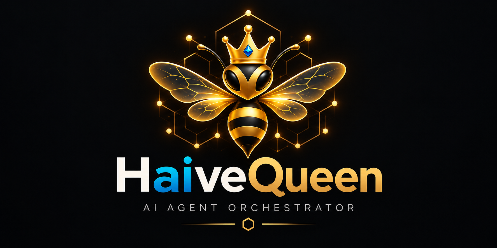
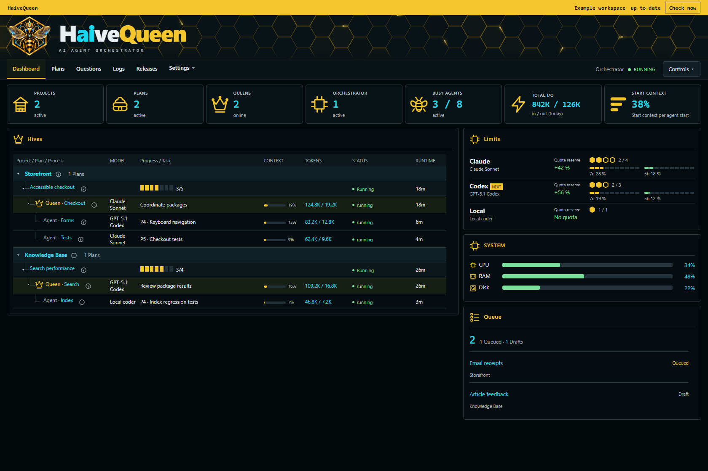

<p align="center">
  
</p>

<p align="center"><strong>Give your coding agents a plan. Follow the work. Review the result.</strong></p>

HaiveQueen coordinates coding agents on your computer, from a written request to a checked result. It splits work into small packages, runs independent tasks in parallel and brings questions back to you in a browser dashboard.

Built for developers managing larger changes or several projects with Claude Code, Codex CLI, OpenCode or Kilo Code. You supply the repository, requirements and provider access; HaiveQueen manages the work between them.

[Get started](#install-and-start) · [Commands](#commands) · [Documentation](#documentation)

## Three quality goals

| Goal | What it means for your work |
| --- | --- |
| **Token economy** | A lean agent profile and a fresh agent for each small package reduce unnecessary starting context. Total usage depends on the task, coordination and verification. |
| **Proven completeness** | Every requirement needs evidence, followed by an independent agent check before integration. You review the result and can request rework. |
| **Parallel work across providers** | Independent packages run concurrently; provider selection accounts for capabilities, available slots and quota. |



*Current web interface, shown with example data.*

## Install and start

You need **Python 3.11 or newer**, **Git**, a browser and at least one supported coding CLI installed. Have a subscription, API key or compatible local model available for that CLI.

**1. Install HaiveQueen.** Open a terminal in the folder where you want to keep it.

Windows PowerShell:

```powershell
git clone https://github.com/Rokk001/HaiveQueen
cd HaiveQueen
py -3 -m venv .venv
.\.venv\Scripts\python.exe -m pip install -e .
.\.venv\Scripts\Activate.ps1
```

Linux:

```bash
git clone https://github.com/Rokk001/HaiveQueen
cd HaiveQueen
python3 -m venv .venv
. .venv/bin/activate
python -m pip install -e .
```

Keep this checkout: the updater uses it. If PowerShell blocks activation, invoke `.\.venv\Scripts\bzz.exe` instead of `bzz`. See the [installation guide](docs/GETTING-STARTED.md) for setup details and troubleshooting.

**2. Connect your project and provider.** Replace `../my-project` with the path to your existing Git repository:

```bash
bzz init ../my-project
bzz register ../my-project
bzz gui
```

In the browser, open **Settings → AI providers**, add your provider, choose its models and use **Login** for subscription access. For API or local-model access, supply the required connection details instead. HaiveQueen uses its own provider profile; your usual CLI login may not be available there. [Provider setup](docs/PROVIDERS.md)

Queen coordination and question/package/integration diagnosis default to **heavy**. Map that class to a capable model with reasoning effort suited to complex work (the shipped example uses `high`). Class, model and reasoning effort are different settings: choosing heavy alone does not make a model stronger. Existing explicit settings are preserved. Higher effort can increase usage; ordinary execution packages can still use smaller models. If no eligible provider offers heavy, scheduling waits for configuration or availability rather than silently choosing medium. Stronger models support these roles but do not replace verification or guarantee successful repairs. [System hardening and verification](docs/SYSTEM-HARDENING.md)

**3. Submit your first request.** In your project's `docs/plans/` folder, create `FIRST-PLAN.md` with this content, replacing the request with your own:

```markdown
+++
status = "SENT"
+++
# Add a health check
Add a /health endpoint that returns HTTP 200 and test the response.
```

Run `bzz start` to begin processing and open the dashboard. HaiveQueen prepares the work packages; you follow progress and answer questions in the browser. Before submitting, review your project's integration settings: enabled Push and Deploy steps run **before** the final owner acceptance. [Plan workflow and acceptance](docs/PLANS.md)

## Technology

Python 3.11+, SQLite for local state, Git worktrees for separate changes, and a browser interface built with HTML, CSS and JavaScript. TOML configuration uses `tomlkit`; model work runs through your configured coding CLIs. The orchestrator itself is a program, not a model.

## Commands

Most day-to-day controls are also in the browser. Expand the reference for every command, including compatibility aliases and agent/runtime operations. Required arguments, permissions and examples are in the [CLI reference](docs/COMMANDS.md).

<details>
<summary>All bzz commands — one-line reference</summary>

| Command | Purpose |
| --- | --- |
| `bzz agent start` | Start a package agent in its assigned worktree. |
| `bzz agent result` | Report an agent attempt and its evidence. |
| `bzz agent history` | Read stored attempt history. |
| `bzz agent wait` | Record that a package is waiting for provider capacity. |
| `bzz agent force-stop` | Owner: stop one eligible agent; its package waits for an instruction. |
| `bzz agent stop` | Compatibility alias for agent force-stop. |
| `bzz bee start` | Compatibility alias for agent start. |
| `bzz bee result` | Compatibility alias for agent result. |
| `bzz bee history` | Compatibility alias for agent history. |
| `bzz bee wait` | Compatibility alias for agent wait. |
| `bzz bee force-stop` | Compatibility alias for agent force-stop. |
| `bzz bee stop` | Compatibility alias for agent stop. |
| `bzz package` | Report package progress and its waiting reason. |
| `bzz package unassign` | Owner: clear a package provider assignment for its next start. |
| `bzz plan check` | Validate a prepared plan and make it eligible to run. |
| `bzz plan accept` | Owner: accept a checked result and close the plan. |
| `bzz plan reject` | Owner: request rework with a finding, optionally for selected packages. |
| `bzz plan stop-gracefully` | Owner: prevent new work for this plan while running work finishes. |
| `bzz plan force-stop` | Owner: immediately stop the plan and its running work. |
| `bzz plan pause` | Compatibility alias for plan stop-gracefully. |
| `bzz plan resume` | Owner: restore a paused plan to its previous status. |
| `bzz plan release` | Owner: bypass the independent check for a branch or specified commit. |
| `bzz provider enable` | Owner: enable a configured provider. |
| `bzz provider disable` | Owner: prevent new assignments to a provider. |
| `bzz provider test` | Owner: test a local-model provider connection. |
| `bzz integration acquire` | Acquire the integration place for a project. |
| `bzz integration release` | Release the integration place for a project. |
| `bzz dequeen` | Owner: stop a plan's Queen and separate agents, leaving it queenless. |
| `bzz requeen` | Owner: restart a plan Queen, optionally on another provider. |
| `bzz done` | Agent: record the final result. |
| `bzz ready` | Queen: submit completed work for independent checking and integration. |
| `bzz compile-check` | Run the configured project check. |
| `bzz ask` | Agent: ask the owner a question with an optional recommendation. |
| `bzz note` | Record a progress note. |
| `bzz status` | Show current project, agent and package status. |
| `bzz questions` | List questions, optionally filtered to open items. |
| `bzz answer` | Answer a question as owner or coordinator. |
| `bzz queue` | List integration queue entries. |
| `bzz queue list` | List integration queue entries. |
| `bzz queue upsert` | Create or update an integration queue entry. |
| `bzz views` | Write project state as Markdown views. |
| `bzz export` | Back up the SQLite database when due, or immediately with --force. |
| `bzz init` | Create local project settings, instruction templates and an example plan. |
| `bzz register` | Register an existing project with this machine. |
| `bzz agents list` | List agent records by project, scope or status. |
| `bzz agents get` | Read one agent record. |
| `bzz agents upsert` | Create or update an agent record. |
| `bzz agents update-fields` | Update selected agent fields. |
| `bzz agents archive` | Archive matching inactive agent records. |
| `bzz event append` | Append an event and optional log mirror. |
| `bzz events list` | Read matching events. |
| `bzz events tail` | Read the most recent events. |
| `bzz events paths` | Resolve event log file locations. |
| `bzz kv get` | Read a project runtime value. |
| `bzz kv set` | Store a project runtime value. |
| `bzz kv delete` | Remove a project runtime value. |
| `bzz kv list` | List project runtime keys. |
| `bzz handled check` | Check whether an item has a handled marker. |
| `bzz handled add` | Record a handled marker. |
| `bzz handled remove` | Remove a handled marker. |
| `bzz handled list` | List handled markers. |
| `bzz nofollow list` | List no-follow markers. |
| `bzz nofollow add` | Add a no-follow marker. |
| `bzz nofollow remove` | Remove a no-follow marker. |
| `bzz build add` | Store a build resource measurement. |
| `bzz build max-per-job` | Read the highest measured memory use per build job. |
| `bzz usage add` | Record model usage. |
| `bzz usage list` | Read recorded model usage. |
| `bzz plans sync` | Read project plan files into runtime state. |
| `bzz plans list` | List stored project plans. |
| `bzz plans set-status` | Update plan status in the file and runtime state. |
| `bzz packages list` | List stored work packages. |
| `bzz packages set` | Update package phase or lock state. |
| `bzz decisions list` | Read project decisions. |
| `bzz decisions update` | Change an existing decision scope or status. |
| `bzz decisions add` | Record a project or plan decision. |
| `bzz run-state` | Read orchestrator run state. |
| `bzz starts-allowed` | Check whether new agents may start. |
| `bzz reattach` | Reconcile stored agents against supplied live process IDs. |
| `bzz import-legacy` | Import supported version 1 runtime files. |
| `bzz start` | Start the background orchestrator and open the browser. |
| `bzz gui` | Open the browser dashboard without starting the orchestrator. |
| `bzz stop` | Prevent new work and let running agents finish; --force stops immediately. |
| `bzz web setup` | Configure network access and authentication. |
| `bzz web off` | Disable network access. |
| `bzz web start` | Start the independent web listener. |
| `bzz web stop` | Stop the independent web listener. |
| `bzz web restart` | Restart the independent web listener. |
| `bzz web serve` | Run the web listener in the current process. |
| `bzz self-update` | Perform the legacy self-hosted update transition when eligible. |
| `bzz update` | Check for a release or install an offered version. |
| `bzz worktrees prune` | Remove eligible integrated worktrees with cleanup checks. |

</details>

## Documentation

| Guide | Use it to… |
| --- | --- |
| [Getting started](docs/GETTING-STARTED.md) | Complete installation and troubleshoot your first run. |
| [Plans and acceptance](docs/PLANS.md) | Write requests, understand status and review results. |
| [Providers](docs/PROVIDERS.md) | Configure models, authentication, quotas and routing. |
| [Browser, tray and service](docs/WEB-API.md) | Use the dashboard, local or network access and background services. |
| [Operations](docs/OPERATIONS.md) | Understand integration, updates, recovery and cleanup. |
| [Settings](docs/SETTINGS.md) | Look up machine and project configuration. |
| [CLI reference](docs/COMMANDS.md) | Find command syntax and arguments. |
| [Inbox](docs/INBOX.md) | Supply answers and decisions through files. |
| [Recorded activity](docs/LIVE-ACTIVITY.md) | Inspect recent agent commands and tools alongside milestones. |
| [Agent profiles](docs/PROFILE.md) | Understand instruction loading and profile separation. |
| [Agent rules](docs/AGENT-RULES.md) | Read the coordination and verification contract. |
| [Branch attribution](docs/BRANCH-ATTRIBUTION.md) | Understand worktree assignment and commit auditing. |
| [Runtime API](docs/RUNTIME-API.md) | Integrate tools with stored runtime state. |
| [Integration diagnostics](docs/INTEGRATION-DIAGNOSTIC-DRAIN.md) | Report final check failures while remaining checks continue safely. |
| [Version 1 migration](docs/MIGRATION-v1.md) | Move from the former PowerShell version. |
| [Development](docs/DEVELOPMENT.md) | Work on HaiveQueen and run focused checks. |
| [Documentation map](docs/DOCUMENTATION-MAP.md) | Trace moved material and find supporting references. |
| [Example files](examples/) · [Agent roles](roles/) | Start from templates or inspect role instructions. |

MIT, see [LICENSE](LICENSE).
