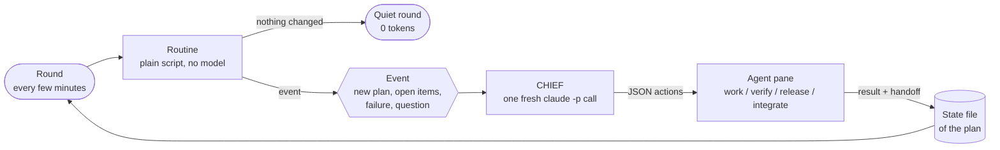

<p align="center">
  
</p>

<p align="center">
  <a href="LICENSE"></a>
  
  
  
  
</p>

<p align="center"><b>Run many Claude Code and Codex agents in parallel, one fresh agent per task, without copying a single prompt.</b></p>

---

## Why

Working through a big plan with AI coding agents means a lot of babysitting: paste the prompt, wait, `/clear`, paste the next one, check the result,
repeat. With several agents at once it gets worse, and a supervising model that just watches burns tokens while it waits.

**agent-orchestrator** removes that loop:

- Many Claude Code and Codex CLI agents work **in parallel**, each in its own terminal pane.
- You **never copy prompts**. The orchestrator reads your plans and builds the prompt for every task itself.
- It is **token-sparing by design**: routine steps are decided by plain scripts. A language model ("CHIEF") is only called when an event needs judgement.

## Features

| | |
|---|---|
| 🧑‍💻 **One fresh agent per task** | Every task gets its own headless agent and its own pane. When the task is done the agent ends and the next task starts in a clean context. |
| 🔁 **work → verify → release → integrator** | A separate verify agent must confirm completeness before a package moves on. Then a release agent prepares the branch and the integrator merges what is ready. |
| 🧠 **CHIEF only on events** | A new plan, a verify answer with open items, a failed agent, a question of the owner: only then one fresh `claude -p` call decides. A quiet round costs **zero** tokens. |
| 📏 **Context limit with handoff** | Every agent stays below a context limit (default 300k tokens). Before it is exceeded the agent writes a handoff, ends, and a fresh agent continues. |
| 📊 **Live dashboard** | Agents, usage limits, token usage, free RAM, running builds, plan counts and open questions in one pane. |
| 🎨 **Agent names and colors** | Every agent gets a short first name and a fixed color, so panes are easy to tell apart. The orchestrator itself is always CHIEF. |
| 💬 **Questions to the owner via files** | Agents and CHIEF put questions into a questions file; you answer in an answers file. No chat window has to stay open. |
| 🔄 **Event sync of a private repo** | The optional `onEvent` hook calls your command once per round with the events of that round, for example to commit and push your plan files. |
| 🎚️ **Model classes light / medium / heavy** | Each package can carry a class. The project file maps classes to a model and effort per agent type; repeated failures escalate to a higher class. |

## How it works



1. Every round, a script reads all plans and state files and applies the fixed routine transitions (work done, then verify, then release, ...).
2. Only if something needs judgement does it become an **event**, and CHIEF is asked once. Its answer is a validated JSON action; the script enforces slots, RAM and plan-status rules before executing it.
3. The chosen action starts a fresh agent in a new pane. The agent writes its result into the plan's **state file** and ends. The next round sees the new state.

## Dashboard

Real output of `dashboard.ps1`, rendered with a throw-away test runtime and neutral fixture data (colors removed here). The dashboard labels are German.

```text
── AGENTEN 3  12:34:56  letzte Runde 12:34:10 ──────────────────────────────────────────
MAX | demo-work-a1 | Claude Son 5.5 med. | ► running 14:00
✎ Add input validation to the parser
Kontext 82k | Total Input 1.4M / Output 21k
LENA | demo-work-b2 | Codex Sol 6.1 med. | ► running 06:00
✎ Write unit tests for the exporter
Kontext 41k | Total Input 620k / Output 9k
ANNA | demo-verify-a1 | Claude Son 5.5 med. | ◌ starting 00:00
⚲ Verify the config loader
Tokens: noch keine Daten
beendet letzte Stunde
JONAS | demo-release-a0 | Claude Son 5.5 med. | ✓ done 23:00
⇪ Release the config loader
Kontext 120k | Total Input 2.1M / Output 30k
── ◔ LIMITS ────────────────────────────────────────────────────────────────────────────
Claude 5h ████░░░░░░  42% in 2h 10m
Claude 7d ██░░░░░░░░  18% in 4d
Codex 5h  ███████░░░  67% in 1h 05m
Codex 7d  ███░░░░░░░  31% in 5d
── Σ VERBRAUCH ─────────────────────────────────────────────────────────────────────────
                                         Sonnet 5.5                          Sol 6.1
heute                 Total Input 3.2M / Output 61k    Total Input 1.1M / Output 24k
alle Pläne           Total Input 9.8M / Output 180k    Total Input 4.2M / Output 90k
gesamt seit 01.10.  Total Input 41.0M / Output 760k  Total Input 18.0M / Output 310k
── ▣ SYSTEM ────────────────────────────────────────────────────────────────────────────
RAM 44% 14.2/32 GB  CPU 23%  ⌘ Build: nein
── ☰ PLAENE ────────────────────────────────────────────────────────────────────────────
DRAFT 1  READY 2  IN_PROGRESS 3  DONE 7  PAUSED 0  (Owner: demo-idea)
── ! FRAGEN ────────────────────────────────────────────────────────────────────────────
offen: 1  Q1
```

## Quick start

**Requirements**

- Windows 10/11 with [PowerShell 7](https://learn.microsoft.com/powershell/) (`pwsh`)
- [Windows Terminal](https://aka.ms/terminal) (`wt.exe`)
- [Claude Code](https://claude.com/claude-code) CLI (`claude`) and/or the Codex CLI (`codex`)
- Optional: Python 3.14 (module `compression.zstd`) for the usage table of compressed Codex logs; `git` for the sync example

**Steps**

```powershell
git clone https://github.com/Rokk001/agent-orchestrator
cd agent-orchestrator

# 1. Copy the example project file and the rules file next to your project and adapt them
Copy-Item examples\project.example.json C:\work\my-project.orch.json
Copy-Item examples\project-rules.example.md C:\work\project-rules.md

# 2. Start (opens the terminal window with log, dashboard and agent panes)
pwsh -File start.ps1 -Project C:\work\my-project.orch.json

# 3. Stop: running agents finish their task, no new agent starts
pwsh -File stop.ps1 -Project C:\work\my-project.orch.json
```

Also create a Windows Terminal profile for the orchestrator window (its name must match `terminalProfile.name`), for example in `settings.json`:

```json
{ "name": "Orchestrator Agent", "commandline": "pwsh.exe", "closeOnExit": "graceful", "font": { "size": 10 } }
```

The rules file is named by `ruleSources.project` in the project file (the example points to `project-rules.md` next to the project file). A second start for the same project refuses to run.

## Plans

A plan is a markdown file. Line 2 is `Status: DRAFT | READY | IN_PROGRESS | DONE | PAUSED` (no status line counts as DRAFT). A table whose first column is
`Package` lists the packages with the columns `Content`, `Depends on` and optionally `Class`. State files (`<plan>-<stateToken>.md`) hold the
results of the agents. Only `READY` and `IN_PROGRESS` plans are started.

## Configuration reference

Everything project-specific lives in one JSON project file; `examples/project.example.json` shows every key. Paths are Windows paths; `{repo}`, `{tools}`, `{home}` and `{projectDir}` are replaced where a path or command is read from the file.

| Key | Meaning |
|---|---|
| `window` | Name of the terminal window |
| `terminalProfile.name`, `terminalProfile.fontSize` | Windows Terminal profile and font size of the window |
| `mutexPrefix` | Prefix of the global mutex names (allows several orchestrators on one PC) |
| `owner` | Name of the person who answers questions |
| `openMarker` | Heading in a state file that opens a question for the owner |
| `pilot`, `pilotPlan`, `pilotMinFreeRamGB` | Pilot mode: only the packages of the pilot plan run and there is no integrator; `pilotMinFreeRamGB` is the free-RAM limit in that mode |
| `claudeSlots`, `codexSlots`, `integratorSlots` | Maximum number of concurrent Claude Code agents, Codex agents and integrators |
| `roundMinutes` | Interval of the orchestration rounds |
| `minFreeRamGB` | Free RAM required before an agent is started, otherwise it waits for the next round |
| `claudeModel`, `codexModel`, `effort` | Default model and effort (the same as the `medium` class) |
| `brainModel`, `brainEffort` | Model and effort of the CHIEF call |
| `contextLimitTokens` | Context limit per agent; at the limit the agent writes a handoff and a fresh one continues (default 300000) |
| `repo` | Repository of the project |
| `runtime` | Runtime folder (agent list, logs, run folders; never commit it) |
| `paneCloseDelaySeconds` | How long a finished agent pane stays open before it closes |
| `claudeArgs`, `codexArgs`, `brainArgs` | Command-line templates of the CLIs (placeholders such as `{model}`, `{effort}`, `{repo}`, `{tools}`, `{cwd}`, `{rules}`, `{claudeTools}`) |
| `claudeTools` | Tool list passed to Claude Code agents |
| `claudeCommandTemplate`, `codexCommandTemplate` | Human-readable examples of the resulting command lines (documentation only, not read by the scripts) |
| `classes` | Model and effort per agent type (`claude`, `codex`) for the classes `light`, `medium`, `heavy` |
| `minClass` | Minimum class per phase (for example `verify` and `integrate` never run below `medium`) |
| `escalateAfter` | Number of failures of a package after which its class is raised by one |
| `bundle.maxPackages` | Maximum number of small packages of one plan that run in a single agent |
| `bundle.startContextTokens`, `bundle.smallestTaskTotalInput` | Measured reference values behind the bundling decision (not read by the scripts) |
| `pythonExe` | Python 3.14 for the usage table of compressed Codex logs |
| `integrationBranch` | Branch the integrator pushes; appears in the agent prompts |
| `plansRoot` | Folder (below `repo`) that holds the plans |
| `planFileRegexes`, `planStemRegexes`, `planStandaloneRegex`, `planSuffixRegex` | How plan files are recognized and how a plan name is derived from a file name |
| `planExcludeNameRegex`, `planExcludeDirRegex` | File names and folders that are not plans |
| `stateToken` | Token in the state file name (`<plan>-<stateToken>.md`) |
| `integrationStateFile` | Integration queue file below the plans root |
| `questionsFile`, `answersFile` | Questions of agents and answers of the owner (relative to `repo`) |
| `integratorInstructions`, `compileCheck`, `buildFlowDoc`, `worktreePrefix` | Names that appear in the agent prompts |
| `ruleSources` | Rule files by name (`orch`, `project`, optionally more) |
| `phaseRules` | Per phase (`work`, `verify`, `release`, `integrate`) the markdown sections of each rule source that go into the system prompt of that phase |
| `prompts` | Prompt templates with `{placeholders}` for follow-up tasks (`fixBlocked`, `answeredQuestion`, `verifyOpenWork`, `restartWork`, `workInMainCheckout`, `workInWorktree`, `release`, `integrator`, `lockQuestion`) |
| `onEvent.command`, `onEvent.workDir`, `onEvent.timeoutSeconds` | Command called once per round with the events of that round, its working folder and its timeout |

The project rules file (`ruleSources.project`) holds the project's own hard rules under `## 1. Hard rules (project)`. The tool rules in
`ORCHESTRATOR.md` and the project rules together form section 1 of the rules every agent gets; CHIEF gets both files.

### onEvent hook

If the project file has `onEvent.command`, the orchestrator collects the events of a round (plan status changed, work finished, verify passed, release finished,
queue row ready or integrated, question asked or answered) and calls the command once at the end of the round with the events as arguments.
No events means no call. If the command fails, the failure is written to `ORCH-EVENTS.log` and the same events are sent again in the next round;
the loop never stops. `examples/sync.example.ps1` commits and pushes a repository on every call.

## FAQ

**Does a quiet round cost tokens?**
No. Routine transitions are decided by scripts. CHIEF is only called when an event needs judgement.

**What happens when an agent runs out of context?**
At the context limit the agent is asked to write a handoff into the plan's state file and ends. A fresh agent continues from that handoff.

**Which agent does which task?**
Graphics-type tasks go to Codex; everything else goes to Claude Code when a slot is free, otherwise to Codex (see `ORCHESTRATOR.md`).

**How do I stop it safely?**
`pwsh -File stop.ps1 -Project <project json>` creates a `STOP` file in the runtime folder. Running agents finish their task, no new agent starts, the loop ends.

**Will the tests touch my real project?**
No. `tests/*.ps1` build a throw-away project from the examples, use a temporary runtime folder and a stub for `wt.exe`.

```powershell
pwsh -File tests/test-s7.ps1     # routine transitions, brain triggers, context limit, finished packages, questions
pwsh -File tests/test-events.ps1 # onEvent hook and the sync example (local bare repository)
pwsh -File tests/test-s10.ps1    # effort classes, bundling, escalation, lock
pwsh -File tests/test-s9.ps1     # rule files per phase
pwsh -File tests/test-restart.ps1
pwsh -File tests/test-panes.ps1
pwsh -File tests/usage-test.ps1
```

## License

MIT, see [`LICENSE`](LICENSE).
