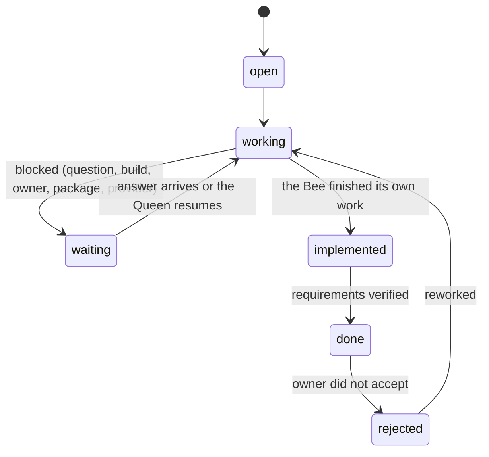

<p align="center">
  
</p>

<p align="center">
  <a href="https://github.com/Rokk001/HaiveQueen/actions/workflows/test.yml"></a>
  <a href="LICENSE"></a>
  
  
</p>

<p align="center"><b>Run plans with Queens and parallel Bees: write a plan, set it to READY, and HaiveQueen works it through.</b></p>

---

HaiveQueen is a local orchestrator for coding agents ([Claude Code](https://claude.com/claude-code) and the Codex CLI out of the box, any other command through a provider entry). You describe the work as a Markdown plan with packages. For every plan HaiveQueen opens a **Hive**: one **Queen** works the plan, starts **Bees** for independent packages, checks that every requirement is met and integrates the result. You watch and steer everything in one graphical window. No prompts to copy, no terminal to babysit.

- [Why](#why) · [How it works](#how-it-works) · [Quick start](#quick-start) · [Plans](#plans) · [Dashboard](#dashboard)
- [Failures and escalation](#failures-and-escalation) · [Configuration](#configuration) · [Inbox](#inbox) · [Command line](#command-line)
- [Documentation](#documentation) · [Development](#development) · [FAQ](#faq) · [License](#license)

## Why

- **Token economy is the first quality goal.** A Bee gets only its package, numbered steps, the paths it needs and the rules it needs, never the whole project instructions. Fresh, small contexts replace one huge one.
- **The manager is not a model.** The Beekeeper is a plain program loop. Models are used only for plan work, so the orchestration itself costs no tokens.
- **Every limit is respected.** Providers are chosen by the free weekly limit; a Hive rests until the reset when its provider is limited.
- **It survives restarts.** State lives in one local SQLite database; after a crash the next start re-attaches to agents that are still alive.

## Words

| Word | Meaning |
|---|---|
| **Apiary** | a project (a repository with a `.haivequeen/project.toml`) |
| **Hive** | one plan of an Apiary, worked by one Queen at a time |
| **Queen** | the main agent of a Hive: works the plan, delegates, checks completeness, integrates |
| **Bee** | a helper agent that works one package for its Queen |
| **Beekeeper** | the managing loop: no model, no window, a hidden background process |

## How it works

1. **Plan.** You write a plan (Markdown with a TOML header, see [Plans](#plans)) and set `status = "READY"`. That is the release; there is no submit step.
2. **Start.** The Beekeeper reads READY and IN_PROGRESS plans, picks a provider that offers the Queen class and starts one Hive per plan within the machine-wide limits. Hives that can resume take precedence over new plans.
3. **Work.** The Queen coordinates and never works a package herself: every package goes to a Bee of its class, respecting dependencies and the Bee limit. She answers technical questions, merges the Bee branches and, when every requirement is done, integrates (git, compile check, build). Image work goes to a provider with the `images` capability; local providers are used when available.
4. **Completeness.** Before integration the Queen answers the completeness question with evidence for every requirement and ends with `Offene Anforderungen: 0`. Partial items count as open. Owner-only play checks are listed separately.
5. **Integration.** She merges the current integration branch into her branch, runs the project check, registers her branch and performs the project's integration steps. Only one integration per project runs at a time; a waiting Hive hands off and resumes when its turn comes.
6. **Acceptance and done.** After integration and deploy HaiveQueen itself files an owner check question (`owner-check`): you test the integrated build and answer `ok`, or say what is not right and the next Queen fixes exactly that. The plan status moves to DONE only after your `ok`; a plan whose header says `owner_check = "none"` skips the question and is done after integration.

Along the way:

- **Handoffs.** At the context limit no new Bees start, running Bees finish and a new Queen continues from the handoff.
- **Questions.** The Queen decides technical questions herself and records the decision (`bzz decisions add`, source `auto`); only game, balance and design questions go to you with `bzz ask`, and a question that an earlier decision or answer already settles is closed by reference. An open owner question pauses only the item it blocks; independent work goes on. Any answer can resume the Hive.
- **Provider limits.** The Hive rests on its provider until the reset. Only the owner may change a Hive's provider.
- **Interruptions** (laptop sleep, network or API errors, a vanished process) are retried with growing waits and never count as failures.

### Package states

Every package moves through a small state machine that the Queen reports with `bzz package`:



`implemented` means the work is written but not yet verified; `waiting` means someone else has to act first. Neither is a failure (see below). A rejected package is never counted as done, and `bzz ready` is refused until it is reworked.

## Quick start

**Requirements**

- Python 3.11 or newer, with tkinter (part of the standard Python installers) for the dashboard window
- the [Claude Code](https://claude.com/claude-code) CLI (`claude`) and/or the Codex CLI (`codex`)
- Git (Hives work in worktrees)

**Steps**

```bash
git clone https://github.com/Rokk001/HaiveQueen
cd HaiveQueen
pip install -e .                      # optional: gives you the command `bzz` (else use `python -m haivequeen`)

bzz init /path/to/my-project          # creates .haivequeen/project.toml, AGENTS.md and an example plan
bzz register /path/to/my-project      # adds the project to config.toml and the database
bzz start                             # starts the loop in the background and opens the dashboard window
bzz stop                              # no new agents; running agents finish their task
```

Put your machine settings (providers, slots) into `config.toml` (see [`examples/config.example.toml`](examples/config.example.toml); folder: `%APPDATA%\HaiveQueen` on Windows, `~/.config/HaiveQueen` on Linux).

The loop and all agents run as hidden background processes; the dashboard window is the only interface. Closing the window leaves the loop running, and `bzz start` opens it again without restarting agents. A start during a pending stop reports that the existing agents must finish first. Windows desktop shortcuts can use `bzz start --desktop` and `bzz stop --desktop` for a visible result or error dialog; ordinary CLI calls keep their JSON output.

## Plans

A plan is a Markdown file with a TOML header between `+++` lines ([`examples/plan.example.md`](examples/plan.example.md)). Only a plan with `status = "READY"` or `"IN_PROGRESS"` starts agents.

```toml
+++
status = "READY"

[[packages]]
id = "P1"
title = "Add the parser"
class = "medium"        # light | medium | heavy: model and effort come from the provider
depends_on = []

[[packages]]
id = "P2"
title = "Draw the icons"
capability = "images"   # only providers with this capability may run it
verify = "owner"        # code (default) | build | owner: who closes the last requirements
depends_on = ["P1"]

[[packages]]
id = "P3"
title = "Final check of the whole plan"
class = "heavy"
depends_on = ["all"]    # waits for every other package of this plan
+++
# My plan
Free Markdown below the header: the agents read it.
```

| Field | Meaning |
|---|---|
| `status` | `READY` releases the plan; `IN_PROGRESS` and `DONE` are set by HaiveQueen; `PAUSED` stops new starts (window: `Space`) |
| `class` | `light`, `medium` or `heavy`; the provider maps each class to a model and an effort |
| `depends_on` | package ids this one waits for, or `["all"]` |
| `capability` | only providers offering it may run the package (for example `images`) |
| `owner_check` | header key (not per package): `"none"` skips the acceptance question after integration, anything else (default) asks you to test the integrated build |
| `verify` | who closes the last requirements: `code` (the Bee does, default), `build` (a build step does) or `owner` (a play check by you). A Bee is done when its own work is. An unknown value is treated as `code` |

A plan may be paused and resumed in the window. A paused plan gets no new Queen or Bee; a running Queen keeps working.

## Failures and escalation

Package classes bind the work: each package is worked at its class, and the Queen escalates to the next offered class only when the current model cannot solve it. Failed attempts are counted per package and class; after `escalateAfter` failures (default 3) the next higher class is used and the count starts again. If no higher class can solve it, the owner is asked. Image packages stay on Codex; after its highest class fails, the owner is asked.

**What counts as a failure** is deliberately narrow: only a model that keeps trying the same thing and does not get it done. These never count and never escalate:

- a package marked `implemented` (the Bee finished; the rest is verification),
- open requirements of a package whose `verify` is `build` or `owner`,
- a Bee that waits for something: `bzz bee result --outcome failed --blocked-by question|build|owner|package|provider` sets the package to `waiting` instead (a question needs `--blocked-ref <question id>`, and the package works again when that question is answered),
- interruptions and provider limits.

A `failed` result without evidence (`--open-requirements` or `--error`) is refused, so a bare "failed" never reaches the counter.

## Dashboard

`bzz start` opens the graphical dashboard once; `bzz gui` opens only the window (`--detach` returns at once, `--project <name>` shows one Apiary). It is written in pure Python (tkinter, no extra packages) and laid out like [`docs/HaiveQueen_Dashboard.png`](docs/HaiveQueen_Dashboard.png); logo and icons are cut out of that picture by `scripts/make_gui_assets.py` into `assets/gui/`.

<p align="center">
  
</p>

**Panels**

- **Active Hives**: one row per Hive with its Apiary, the name of its Queen, Bees running of assigned, a progress bar (finished packages), status and runtime. The detail line below the table shows the selected Hive's packages (done, implemented, rejected, waiting with the reason) and its token total.
- **Queens and Bees**: every running Queen is a parent row, her Bees hang directly below her. A Queen row carries all Queen data: model and effort, Hive, context fill, tokens and runtime. Bees that have no process yet show as `waiting`.
- **Tokens, system, queue**: token use per Apiary and Hive, load of the machine and the integration queue.
- **Logs**: the newest events with coloured source tags, with save, clear and auto-scroll.
- **Model limits** and **Status**: the provider windows and weekly quotas as bars, and run state, plans, questions and round errors as text.

Every list that does not fit has a scroll bar (or use the mouse wheel).

**Controls**

| Control | What it does |
|---|---|
| state button (bottom left) | shows RUNNING, PAUSED, STOPPING or STOPPED and opens a menu with the actions that fit: pause or resume, stop, start |
| `apiaries` | filter by Apiary (key `F`) |
| `questions` | answer the open owner questions (key `Q`); for an owner check, tick the steps you do not accept: they become rejected and the Queen reworks exactly those; inbox files still work |
| `config` | settings editor, see below |
| `help` | the keys |
| `Tab` | switch between the Hives table and the Queens-and-Bees table; `Up`/`Down` move the selection in the active table |
| `Enter` / double click | live output of the selected row |
| `M` / right click | Queen menu for the Hive or Queen row: restart the Queen, end Queen and Bees, pause or resume the plan |
| `Space` | pause or resume the plan of the selected Hive |
| `P` | pause or resume all new starts |
| `X` | stop the selected Bee (a Queen or a not yet started Bee only gets a hint) |
| `C`, `S`, `A` | clear, save, auto-scroll the log |

A click on the repository name in the header opens the GitHub page. Pause, resume, stop and every Queen action ask for a confirmation first. All messages, questions, menus and the questions and settings windows share the dashboard's dark look; only the file dialog of "save log" is the system one.

**Settings.** The `config` entry opens an editor for `config.toml` and the `project.toml` of every Apiary as forms: General, one page per provider (the Claude allowed tools as their own list, one tool per line) and one per project. Save checks the settings the way the loop does when it reloads them, keeps the old file as `<name>.bak` and keeps the comment lines at the top of the file; the running HaiveQueen applies the change without a restart. Comments inside the file are not kept.

**Live output.** `Enter` on a Hive row opens a read-only window with the last 300 lines of the running Queen of that Hive (the latest one when none runs); on a Queen or Bee row it shows that agent. The window reloads every 2 seconds, follows the end of the text, and opening the same agent again focuses its window. The text is `milestones.txt` in the agent's run folder (`<data>/runs/<project>/<agent>/`); `runner.log` next to it holds the plain runner output.

## Configuration

Machine `config.toml` holds `hives` (default 2), `preferredProvider`, `excludedProviders`, provider `slots`, provider `classes` and the machine resource settings. `queenClass` (default `medium`) and `beesPerQueen` (default 3) may be set in the machine config or overridden in a project. Per provider, `beeMode` chooses how the Bees of that provider's Queen run: `subagent` (embedded, small context, no extra slot; default for Claude) or `process` (a separate agent each; default for Codex); it can also be changed in the settings window. `escalateAfter` defaults to 3. `contextLimitTokens` defaults to 300000: set it once for all Apiaries; a project may override it, and a model entry under `[providers.classes]` may carry its own value that wins for Queens and Bees running with that model. Project settings override machine settings except the machine-wide ones. See [`examples/config.example.toml`](examples/config.example.toml) and [`examples/project.example.toml`](examples/project.example.toml).

- **Quotas.** Claude subscription quotas are refreshed at most once per minute with the local CLI `/usage` metadata command, without model turns, hooks, MCP servers or saved sessions. The dashboard and scheduling share the verified account windows; a failed refresh hides the old percentage and pauses automatic Claude selection until a refresh succeeds.
- **Reload.** Saved changes to the machine `config.toml` and to registered projects' `.haivequeen/project.toml` are reloaded at the next poll, also while idle, without restarting running agents. Valid changes wake scheduling at once; an invalid or temporarily missing file keeps the complete last valid settings. An explicit `--round-minutes` still takes precedence.

## Inbox

Every project has an inbox folder: `<workspace>/.haivequeen/inbox/`. Anyone (the owner, a coordinator, a script) can leave answers and decisions there as TOML files, and the Beekeeper takes them over at the start of the next round. No command needed.

- Only files that end in `.toml` (UTF-8) are read, oldest first. Write a file as `<name>.toml.tmp` and rename it when it is complete; other endings are ignored.
- A file holds `[[answer]]` tables (`question_id`, `text`, `by` = `owner` or `coordinator`) and `[[decision]]` tables (`text`, `source` = `owner` or `coordinator`, optional `plan` and `item`). See [`examples/inbox.example.toml`](examples/inbox.example.toml).
- It may also hold `[[queue]]` tables, orders to the integration queue: `branch`, `action` (`withdraw`, `mark_cleanup` or `requeue`), `reason` and an optional `tip` (full or abbreviated commit id; without it every row of the branch is meant). `withdraw` sets the ready or blocked row(s) to `withdrawn`, but only when the tip is contained in `origin/<integrationBranch>` (checked with `git merge-base --is-ancestor`) or the reason is exactly `ueberholt`; otherwise the whole file moves to `inbox/failed/`. `mark_cleanup` stores the mark `erledigt, Aufraeumen erlaubt: <reason>` for the branch; no row changes and nothing is deleted. `requeue` sets the newest ready or blocked row back to `ready` for the next integration run. A row that is in a run or already integrated is never touched.
- Values go through the same functions as `bzz answer` and `bzz decisions add`: same checks, same events, and a Hive waiting for an answer can resume.
- A file is taken over completely or not at all, then moves to `inbox/done/<YYYYMMDD-HHMMSS>-<name>.toml`. An invalid file moves to `inbox/failed/` with `<name>.error.txt` next to it that names the reason and the line, and a warning event is written.

## Command line

| Command | Who | What it does |
|---|---|---|
| `bzz start` / `bzz stop` | owner | start the loop in the background and open the dashboard (`--foreground`, `--rounds N`, `--round-minutes M`), or stop starting new agents |
| `bzz gui [--detach] [--project p]` | owner | open the graphical dashboard window |
| `bzz pause` / `bzz resume` | owner | pause new starts, or resume them |
| `bzz status [--project p] [--json]` | owner | "X / Y integrated (%)" and a task / agent / status table per project |
| `bzz questions [--open]`, `bzz answer <id> "<text>" --by owner` | owner | read and answer questions of the agents |
| `bzz queue [upsert]` | owner, Queen | the integration queue |
| `bzz decisions list [--all]`, `bzz decisions update <id> --status active\|rule\|superseded` | owner | decisions; the list shows only `active` ones unless `--all` |
| `bzz init <folder>`, `bzz register <folder>` | owner | create and register a project |
| `bzz export`, `bzz views --project p` | owner | export the state, write the Markdown views |
| `bzz import-legacy ...` | owner | import the state of version 1 (see [`docs/MIGRATION-v1.md`](docs/MIGRATION-v1.md)) |
| `bzz dequeen <hive>` / `bzz requeen <hive> [provider]` | owner | leave a Hive queenless or start a new Queen, optionally on another provider |
| `bzz bee start`, `bzz bee result`, `bzz bee wait` | Queen | start a Bee (a refused start answers `waiting` with a `reason`), record an attempt or wait for its provider; a failed result needs evidence (`--open-requirements` or `--error`) or `--blocked-by question\|build\|owner\|package\|provider` (a question also needs `--blocked-ref <id>`), which is no failure and sets the package to waiting |
| `bzz package --project p --plan f --package id --state working\|waiting\|implemented\|done\|rejected [--reason ...]` | Queen | report the progress of a package; `waiting` needs `--reason` (`question:<id>`, `build`, `owner`, `package` or `provider`); the window's progress bar counts the done ones |
| `bzz integration acquire` / `release` | Queen or external window | acquire or release the per-project integration place; external windows provide a stable owner process id |
| `bzz done`, `bzz ready`, `bzz ask`, `bzz note` | agents | final report, branch ready for integration, question, note ([`docs/RUNTIME-API.md`](docs/RUNTIME-API.md)) |

## Good to know

- Completed idle Hives are reconciled with the plan status and confirmed integration; active agents and genuine owner questions are preserved.
- A Hive without a Queen shows its recorded start blocker or the numbers of its pending questions instead of a generic waiting label.
- Automatic worktree cleanup requires confirmation that the branch's current commit was integrated; a missing or superseded confirmation keeps the worktree.
- Round totals count actual Queen launches, independent of earlier run timestamps.
- Pause prevents new Queens and separate Bee processes until you resume; stop lets running agents finish and then ends HaiveQueen. Existing subagents continue.

## Documentation

| File | Content |
|---|---|
| [`docs/AGENT-RULES.md`](docs/AGENT-RULES.md) | the hard rules every Queen and Bee follows |
| [`docs/RUNTIME-API.md`](docs/RUNTIME-API.md) | the JSON commands agents use to read and write state |
| [`docs/MIGRATION-v1.md`](docs/MIGRATION-v1.md) | moving from version 1 (PowerShell) to version 2 (Python) |
| [`examples/`](examples) | machine and project settings, a plan, an inbox file and an `AGENTS.md` |

## Development

HaiveQueen uses only the Python standard library. The tests need no extra packages:

```bash
python -m unittest discover -s tests-py -v
```

CI runs the suite on Windows and Linux with Python 3.11 and 3.14, plus a tmux smoke test on Linux. Window tests skip themselves without a display.

## FAQ

**Does HaiveQueen call a model all the time?** No. The Beekeeper runs without a model; Queens and their Bees use models for plan work.

**Which agents can I use?** Claude Code and the Codex CLI out of the box; any other command through the `providers` list.

**Why did my package escalate to a bigger model?** Only when the current model tried the same thing repeatedly and did not get it done. Waiting for an answer, a build or you never counts, see [Failures and escalation](#failures-and-escalation).

**Where does the state live?** In one SQLite database in the data folder. It must be on a local disk, never on a network drive (SQLite WAL needs it; the tool refuses to open it there). Export it with `bzz export`; Markdown views are generated read-only.

**Can I stop it safely?** Yes. `bzz stop` starts no new agent and waits; after a crash the next start re-attaches to agents that are still alive.

**I used version 1 (PowerShell).** See [`docs/MIGRATION-v1.md`](docs/MIGRATION-v1.md).

## License

MIT, see [LICENSE](LICENSE).
