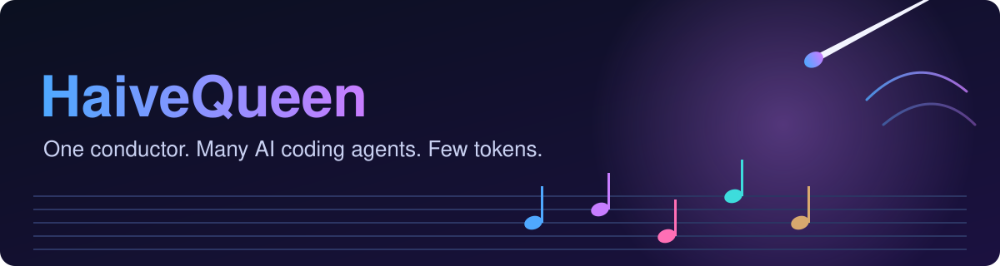
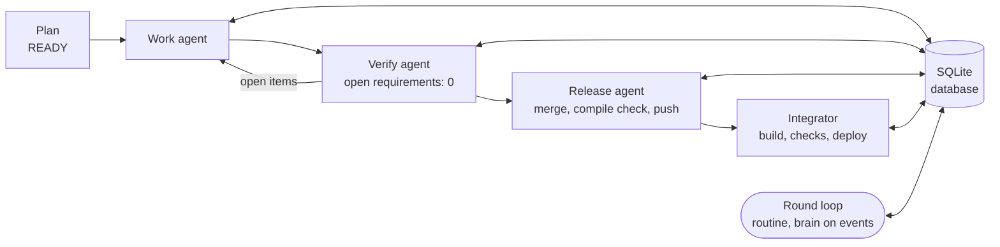

<p align="center">
  
</p>

<p align="center">
  <a href="https://github.com/Rokk001/agent-orchestrator/actions/workflows/test.yml"></a>
  <a href="LICENSE"></a>
  
  
</p>

<p align="center"><b>Run many Claude Code and Codex agents in parallel, one fresh agent per task, without copying a single prompt.</b></p>

---

## Why

Working through a big plan with AI coding agents means a lot of babysitting: paste the prompt, wait, `/clear`, paste the next one, check the result, repeat.
With several agents at once it gets worse, and a supervising model that just watches burns tokens while it waits.

**agent-orchestrator** removes that loop. It reads your plans, builds the prompt for every task itself, starts a fresh agent for it and checks the result with a second, independent agent.
A language model is only asked when something needs judgement; everything routine is plain Python.

## Features

- **Multi-project**: one loop serves many projects; a free slot goes to the project with the highest `priority`, ties to the oldest waiting package.
- **Providers with weekly-limit balancing**: Claude Code, Codex CLI or any command you list; the scheduler picks the provider with the most weekly limit left.
- **Local LLMs**: a provider entry can point at an OpenAI-compatible endpoint (for example LM Studio).
- **One fresh agent per task**: own headless agent, own pane; work, then an independent verify, then release, then the integrator.
- **Triage**: when a package is locked after repeated open points, a triage agent decides technical points itself and asks you only about game or design decisions.
- **Pause and drain**: `P` pauses or resumes new starts, `D` lets running agents finish; a restart re-attaches to agents that are still alive.
- **Build jobs**: parallel build jobs are chosen per machine from the cores and the free RAM, and measured per job.
- **SQLite state**: one database holds agents, events, questions, decisions and the integration queue; Markdown views can be exported.
- **Dashboard**: agents, usage limits, token use, RAM, builds, plans and open questions in one pane.
- **Windows Terminal or tmux**: panes are opened with `wt` on Windows and `tmux` on Linux; a headless backend runs the tests.

## How it works



1. Every round the loop syncs the plans of all projects into the database and applies the fixed transitions (work done, then verify, then release, then integrate).
2. Only if something needs judgement does it become an **event**, and the brain (one fresh `claude -p` call) is asked once. Its answer is a validated JSON action.
3. A started agent writes its result to the plan's state, reports with `orch done` / `orch ready` / `orch ask` and ends. The next round sees the new state.

## Dashboard

Rendered by the tool itself from a throw-away runtime with invented data (the script `scripts/make_dashboard_svg.py` converts the ANSI output to SVG, no screen capture).

<p align="center"></p>

## Quick start

**Requirements**

- Python 3.11 or newer
- [Claude Code](https://claude.com/claude-code) CLI (`claude`) and/or the Codex CLI (`codex`)
- [Windows Terminal](https://aka.ms/terminal) (`wt`) on Windows, or `tmux` on Linux

**Steps**

```bash
git clone https://github.com/Rokk001/agent-orchestrator
cd agent-orchestrator
pip install -e .                       # optional: gives you the command `orch` (else use `python orch.py`)

orch init /path/to/my-project          # creates .orchestrator/project.toml, AGENTS.md and an example plan
orch register /path/to/my-project      # adds the project to config.toml and the database
orch start                             # opens the orchestrator window and the dashboard
orch stop                              # no new agents; running agents finish their task
```

Put your machine settings (providers, slots) into `config.toml` (see `examples/config.example.toml`; folder: `%APPDATA%\agent-orchestrator` on Windows, `~/.config/agent-orchestrator` on Linux).

## Plans

A plan is a Markdown file with a TOML header (`examples/plan.example.md`). Only a plan with `status = "READY"` or `"IN_PROGRESS"` starts agents.

```toml
+++
status = "READY"

[[packages]]
id = "P1"
title = "Add the parser"
class = "medium"        # light | medium | heavy: model and effort come from the provider
agent = "claude"        # claude, codex or any provider name
depends_on = []

[[packages]]
id = "P2"
title = "Draw the icons"
capability = "images"   # only providers with this capability may run it
depends_on = ["P1"]
+++
# My plan
Free Markdown below the header: the agents read it.
```

## Configuration

`config.toml` (machine): `slots`, `buildJobs` (0 = automatic), `ramReserveMb`, `[[providers]]` (name, protocol, command, args, slots, use = preferred | fallback | capability-only, classes, limit) and `[[projects]]`.

`.orchestrator/project.toml` (per project): `name`, `colour`, `priority`, `planGlobs`, `[views]` and the branch and build settings. See `examples/`.

## Command line

| Command | Who | What it does |
|---|---|---|
| `orch start` / `orch stop` | owner | start the loop (`--terminal auto/wt/tmux/headless`, `--rounds N`), or stop starting new agents |
| `orch pause` / `orch resume` / `orch drain` | owner | pause new starts, resume, or let the running agents finish |
| `orch status [--project p] [--json]` | owner | "X / Y integrated (%)" and a task / agent / status table per project |
| `orch questions [--open]`, `orch answer <id> "<text>" --by owner` | owner | read and answer questions of the agents |
| `orch queue [upsert]` | owner, integrator | the integration queue |
| `orch init <folder>`, `orch register <folder>` | owner | create and register a project |
| `orch export`, `orch views --project p` | owner | export the state, write the Markdown views |
| `orch import-legacy ...` | owner | import the state of version 1 (see `docs/MIGRATION-v1.md`) |
| `orch triage ...` | triage agent | list, decide or ask about the open points of a locked package |
| `orch done`, `orch ready`, `orch ask`, `orch note` | agents | final report, branch ready for integration, question, note (`docs/RUNTIME-API.md`) |

## FAQ

**Does the orchestrator call a model all the time?** No. A model is called only on events (new plan, open items, failure, question) and for triage.

**Which agents can I use?** Claude Code and Codex CLI out of the box; any other command through the `providers` list.

**Where does the state live?** In one SQLite database in the data folder. It must be on a local disk, never on a network drive (SQLite WAL needs it; the tool refuses to open it there). Export it with `orch export`; Markdown views are generated read-only.

**Can I stop it safely?** Yes. `orch stop` starts no new agent and waits; after a crash the next start re-attaches to agents that are still alive.

**I used version 1 (PowerShell).** See `docs/MIGRATION-v1.md`.

## License

MIT, see [LICENSE](LICENSE).
