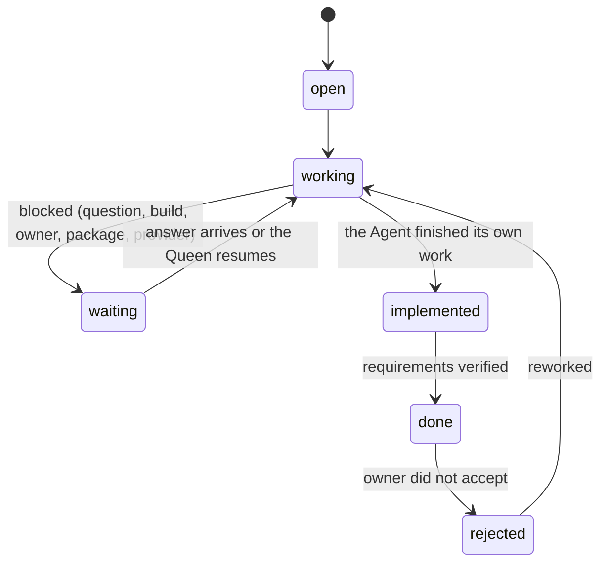

# Plans and requirements

The standard submission is `status = "SENT"`. The Queen cuts the plan and `bzz plan check` sets QUEUED after validation. Set QUEUED directly only for a plan that is already cut, with valid packages, requirement coverage, branch and worktree.

A plan is a Markdown file with a TOML header between `+++` lines ([`examples/plan.example.md`](../examples/plan.example.md)). Only a plan with one of the statuses `SENT`, `PREPARING`, `QUEUED`, `RUNNING`, `WAITING` or `REVIEW` starts agents. A broken header, an unknown status or an unknown class is shown as an error on the Plans page. The plan header records `branch` and `worktree`. At the cut the Queen takes them from the plan or uses the default branch `<plan file name in lower case without -PLAN>` and its project worktree; `bzz plan check` requires both and rejects the main checkout. When the branch already exists and the plan has no run history, you are asked whether to take it over or create a new one.

```toml
+++
status = "QUEUED"
branch = "example-change"
worktree = "../example-change"

[[packages]]
id = "P1"
title = "Add the parser"
requirements = ["R-1"]
class = "medium"        # light | medium | heavy: model and effort come from the provider
depends_on = []

[[packages]]
id = "P2"
title = "Draw the icons"
class = "medium"
requirements = ["R-2"]
capability = "Image generation"   # only providers with this capability may run it
verify = "owner"        # code (default) | build | owner: who closes the last requirements
depends_on = ["P1"]

[[packages]]
id = "P3"
title = "Final check of the whole plan"
requirements = ["R-1", "R-2"]
class = "heavy"
depends_on = ["all"]    # waits for every other package of this plan
+++
# My plan
## Requirements
- R-1: Add the parser with focused tests.
- R-2: Add the application icons.
```

| Field | Meaning |
|---|---|
| `status` | `DRAFT` -> `SENT` -> `PREPARING` -> `QUEUED` -> `RUNNING` <-> `WAITING` -> `REVIEW` -> `DONE`, plus `PAUSED` and `CANCELLED`. `SENT` hands over a plan that is not cut yet (see below); `QUEUED` releases a cut plan; `PREPARING` (a Queen cuts it), `RUNNING`, `WAITING` (every open package waits; the Plans page says what for), `REVIEW` (integrated, waits for your owner check) and `DONE` are set by HaiveQueen; `PAUSED` stops new starts (plan menu: **Stop gracefully**, then **Resume** to continue); `CANCELLED` never starts again by itself. The old names `SUBMITTED`, `READY`, `IN_PROGRESS` and `REJECTED` are read as `SENT`, `QUEUED`, `RUNNING` and `CANCELLED` and written with the new name at the next status change |
| `class` | `light`, `medium` or `heavy`; the provider maps each class to a model and an effort |
| `depends_on` | package ids this one waits for, or `["all"]` |
| `capability` | only providers offering it may run the package. The name is free: you define it in the provider entry of the machine settings (`capabilities = ["Coding", "Queen", "Image generation", "3D modelling", "Build"]` and `capabilitiesVersion = 1`) and several providers may offer the same one, for example `3D modelling` or `Build` for work that only some models are suited for. A package whose provider is missing waits alone; one that another provider offers too goes there. |
| `owner_check` | header key (not per package): `"none"` skips the acceptance question after integration, anything else (default) asks you to test the integrated build |
| `verify` | who closes the last requirements: `code` (the Agent does, default), `build` (treated as code verification before ready; the pipeline builds afterwards) or `owner` (an owner check by you). An Agent is done when its own work is. An unknown value is treated as `code` |

**Submitting a plan that is not cut yet.** Write the plan as free Markdown under a header that only says `status = "SENT"`. The plan gets a run and a Queen like any other, and her first step is to cut it: she reads the text and the capabilities of the configured providers, writes `branch`, `worktree` and the packages (id, title, class, `depends_on`, `verify`) into the header and makes work that only some providers can do (any capability that not every provider offers, such as `Image generation`) a package of its own with `capability`. `bzz plan check` then verifies the header (at least one package, unique ids, a title each, known dependencies without a cycle, every capability offered by a configured provider); when it passes the plan becomes `QUEUED` and the Queen starts Agents. It also warns (without blocking) when a package without a capability waits for one that needs a capability, because that package then stops whenever the provider is missing. `bzz agent start` is refused while a plan is still `SENT` or `PREPARING`. Plans whose header already lists packages run as before. A package that waits for a missing provider stops only itself: the Queen keeps working every other package that can start, and the Plan waits only when none can.

**Plan menu.** Click the **Plan** button beside a plan on the Dashboard or Plans page. **Restart Queen on `<provider>`** has one entry for every provider offering the Queen class; the current provider is marked. **Stop gracefully** prevents new Queens, Agents, embedded subagents and ready-check agents from starting for that plan; a running Queen keeps working and running Agents finish. **Force stop** ends its Queen, Agents and running integration step immediately and leaves the plan stopped. **Resume** continues a stopped plan. **Cancel plan** cancels a draft or stopped plan. **Start** submits a draft or cancelled plan; **Back to draft** returns a stopped or cancelled plan to draft. Actions are offered according to the plan's state.

## Package states

Every package moves through a small state machine that the Queen reports with `bzz package`:



`implemented` means the work is written but not yet verified; `waiting` means someone else has to act first. Neither is a model failure; see [diagnosis](OPERATIONS.md#failures-and-diagnosis). A rejected package is never counted as done, and `bzz ready` is refused until it is reworked.

## Completeness and acceptance

The Queen records every requirement exactly once in the state file under `## Completeness`, with a done status and concrete evidence. Missing, open or partial entries prevent ready. A fresh independent agent checks the submitted plan against this evidence and branch; only its passing verdict (or explicit owner release) accepts ready. The full gate and exceptions live in [Agent rules](AGENT-RULES.md).

After acceptance, the [integration and owner-check workflow](OPERATIONS.md#integration) applies. [Branch attribution](BRANCH-ATTRIBUTION.md) explains worktree assignment and commit evidence.

## Browser drafts and submission

The browser's New plan workflow chooses a registered project and saves typed or imported UTF-8 Markdown to that project's configured plans workspace. The project-relative filename must end in `.md`, match its effective plan patterns, and avoid its exclusions. The suggested folder is only a starting point: custom patterns can require a different filename. Unknown projects, traversal, paths resolving outside the workspace, undiscoverable hidden files, existing files and previously registered plan paths are refused.

Saving validates the TOML header and Markdown heading and preserves the Markdown body, including requirements. A new import always becomes DRAFT; other valid header metadata, including owner review policy and branch/worktree choices, is preserved for review and normal preparation checks on explicit submission. Importing RUNNING or QUEUED never starts work. Existing draft edits retain their header metadata but remain DRAFT. Only an idle draft can be edited, and a content revision prevents overwriting another edit. Creation and editing use the scheduler lock and coordinated file transaction; recovery blocks are respected.

Save draft and Submit are separate actions. Submit uses the existing `plan/start` action, changing DRAFT to SENT for the normal Queen preparation process. No alternate inbox, queue or preparation system is created. The authenticated browser API exposes `plans/create` (`project`, `filename`, `content`) and `plans/save` (`project`, `plan`, `content`, `revision`); both return the plan path and its new revision. The existing plan reader supplies the revision and open questions for that plan.

The plan listing exposes an optional `title` from the discovered Markdown heading so clients can show the actual request name. The existing filename-based `name` and `plan_path` remain unchanged. Missing, database-only and headingless plans have no `title`; clients can use the existing `name` as their fallback.
